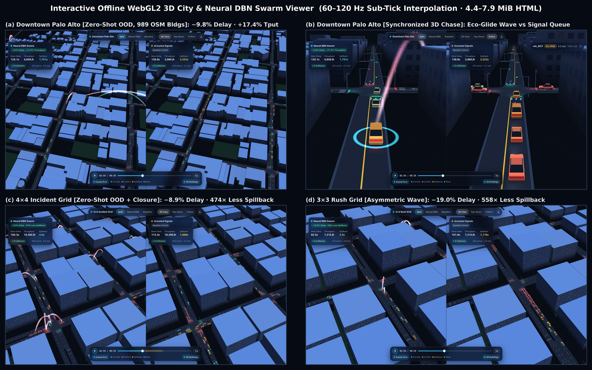
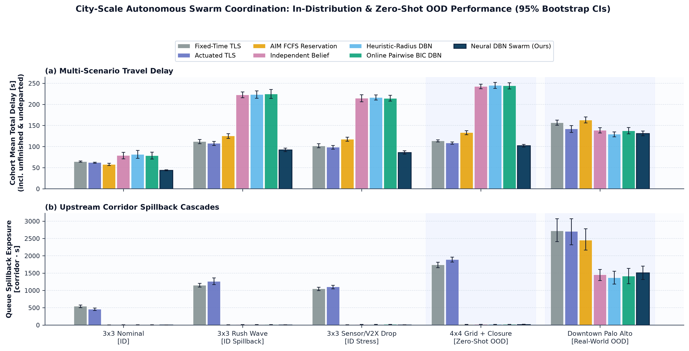
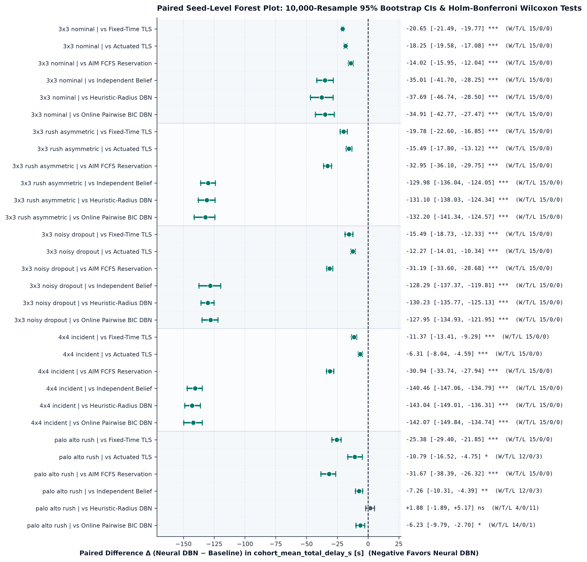
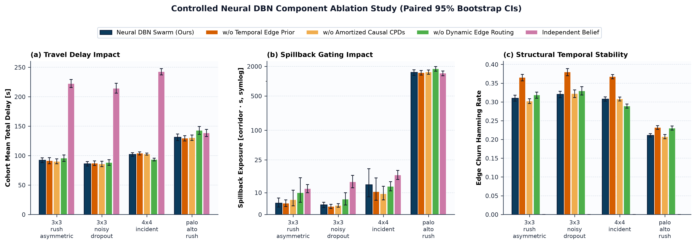
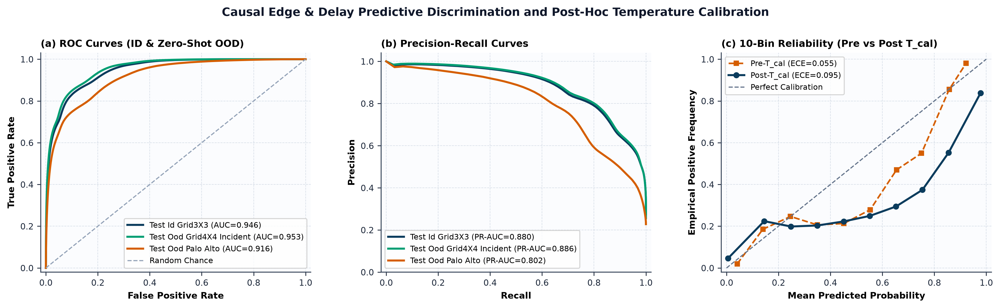
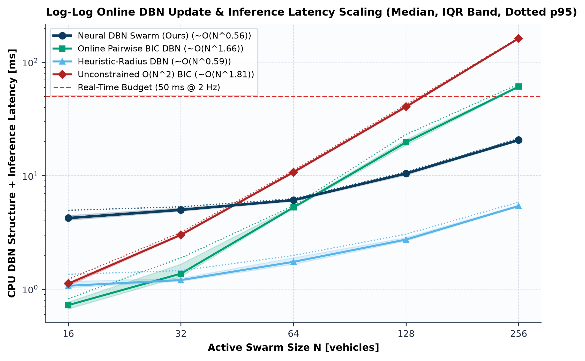

# City-Scale Neurally Updated Dynamic Bayesian Networks for Autonomous Vehicle Swarm Coordination

[](tests/)
[](swarm/env/sumo_adapter.py)
[](https://github.com/zubadestroyer1/bn-vehicle-swarm-coordination/releases)

A research-grade framework for **multi-intersection autonomous vehicle (AV) swarm coordination under partial observability** in [Eclipse SUMO](https://eclipse.dev/sumo/). At every $0.5\text{ s}$ decision tick, a **Heterogeneous Spatio-Temporal Graph Transformer (`STGraphTransformerDBN`)** amortizes directed causal structure updates and Generalized Causal Noisy-OR conditional probability distributions (CPDs) over filtered kinematic and turn-intent beliefs—scaling to **Zero-Shot Out-of-Distribution (OOD)** urban arterial incidents (`grid4x4_incident`) and real-world OpenStreetMap **Downtown Palo Alto / University Avenue** (`361` drivable street edges, `275` corridors, `26` signalized intersections, `88` unsignalized intersections, and `989` 3D buildings) without simulator ground-truth access.



*Synchronized split-screen offline WebGL2 3D replay on Zero-Shot Real-World OpenStreetMap **Downtown Palo Alto / University Avenue** (`osm_palo_alto_rush`, `seed=3000`): **Neural DBN** (left: `125.08 s` mean delay, `4,650 veh/h` throughput, `1,751.0 corridor·s` spillback) vs. **Gap-Actuated Traffic Signals** (right: `138.63 s` mean delay, `3,960 veh/h` throughput, `2,521.5 corridor·s` spillback), rendering 989 extruded OSM 3D buildings, live TLS heads, corridor spillback heatmaps, and glowing parabolic causal DBN arcs.*

---

## Documentation & Release Artifacts

- **[Mathematical & Algorithmic Specification (`docs/METHODS.md`)](docs/METHODS.md)**: POMDP Boundary Locks A/B/C, Joseph-form OOSM Kalman + $\mathrm{Cat}(K_c)$ turn belief filtering, heterogeneous `STGraphTransformerDBN`, Generalized Causal Noisy-OR CPDs, division-free prefix-suffix loopy belief propagation, factored Damped Max-Sum + `PriorityDAGScheduler` coordination, and non-parametric statistical protocol.
- **[Complete Empirical Record & Honest Limitations (`docs/RESULTS.md`)](docs/RESULTS.md)**: Full scenario-by-scenario tables across all **915 held-out closed-loop SUMO episodes** (`525` main + `300` ablations + `90` XL scaling), **55 validation + held-out test rollout shards** for predictive calibration, CPU latency scaling (`N = 16..256`), and transparent collision/stop/covariate-shift failure-mode analysis.
- **[Pretrained Checkpoints (`v0.2.0-models`)](https://github.com/zubadestroyer1/bn-vehicle-swarm-coordination/releases/tag/v0.2.0-models)**: Calibrated `sota_local` (`3,553,746` params, SHA-256 `6a41cfe8225432919922a209eef48bd0abafaf22330d94f2c04a98836ea8c8e5`) and `sota_cloud_xl` (`26,405,714` params, SHA-256 `25235ea3d54784896928a9dc7592cca31a535f9d9c8b5f68ab290d6b77c1afb8`) checkpoints trained on an `NVIDIA A100-SXM4-40GB` (`bf16`, PyTorch `2.14.1+cu130`, CUDA `13.0`).
- **[Rollout Supervision Shards (`v0.2.0-data`)](https://github.com/zubadestroyer1/bn-vehicle-swarm-coordination/releases/tag/v0.2.0-data)**: Pre-collected `NPZ` trajectory rollout splits (`40` train on `TRAIN_SEEDS = 1000..1039`, `10` validation on `VAL_SEEDS = 2000..2009`, and `45` held-out ID + OOD test shards on `TEST_SEEDS = 3000..3014`).

---

## Interactive Self-Contained WebGL2 3D City & DBN Viewer

Every simulation or paired comparison compiles directly into a **single-file, zero-dependency offline WebGL2 HTML replay** (`swarm_3d_soa_v2` codec in [`swarm/viz/viewer_3d.py`](swarm/viz/viewer_3d.py)):

- **Compact Offline SoA + Gzip Codec (`4.44–7.91 MiB`)**: Interns vehicle metadata and quantizes dual-policy 1,080-frame urban trajectories into Structure-of-Arrays buffers compressed with deterministic Level-6 Gzip + Base64 (`~25×–30×` smaller than raw JSON), decompressing natively via browser `DecompressionStream` in **`156–396 ms`** with **zero external HTTP/CDN URLs**.
- **`60–120 Hz` Sub-Tick Cubic Hermite Interpolation**: Smoothly interpolates `2 Hz` (`Δt = 0.5 s`) physical positions, headings, wheel bases, and signal states at display refresh rate without discrete stepping artifacts.
- **Causal Graph & Urban Scene Layers**: Renders glowing parabolic directed DBN edges color-coded by `RelationType` (`SAME_CORRIDOR`, `SAME_JUNCTION_CONFLICT`, `DOWNSTREAM_SPILLBACK`, `UPSTREAM_FEEDER`), extruded 3D OSM/procedural city blocks, live R/Y/G signal heads, and corridor spillback heatmaps inside a minimalist **3-island frosted-glass HUD** with synchronized split-screen camera orbit/pan/zoom.

### Pre-Built Split-Screen Replays & Regeneration Commands

| Replay Artifact | Urban Topology & Regime | File Size | Boot Load | Paired `seed=3000` Outcome (`Neural DBN` vs. `Actuated Signals`) |
| :--- | :--- | :---: | :---: | :--- |
| `outputs/replays/palo_alto_3d_comparison.html` | **Zero-Shot OOD Downtown Palo Alto** (`361` edges, `26` TLS, `989` OSM 3D buildings) | `7.91 MiB` | `396.2 ms` | **`125.08 s`** vs `138.63 s` delay; **`4,650`** vs `3,960 veh/h`; **`1,751.0`** vs `2,521.5 corr·s` spillback |
| `outputs/replays/grid4x4_incident_3d_comparison.html` | **Zero-Shot OOD `4×4` Arterial Incident** (`144` edges, `16` TLS, `100` 3D buildings, mid-run lane closure) | `7.39 MiB` | `202.1 ms` | **`102.31 s`** vs `112.33 s` delay; **`691/691`** vs `686/691` completed; **`4.0`** vs `1,896.0 corr·s` spillback |
| `outputs/replays/grid3x3_rush_3d_comparison.html` | **In-Distribution `3×3` Asymmetric Rush** (`84` edges, `9` TLS, `64` 3D buildings) | `4.44 MiB` | `156.0 ms` | **`82.46 s`** vs `101.76 s` delay; **`2.0`** vs `1,116.0 corr·s` spillback; **`225.99`** vs `253.23 g/veh` CO₂ |

```bash
# Open any pre-built offline 3D split-screen replay directly in a browser (macOS: open; Linux: xdg-open)
open outputs/replays/palo_alto_3d_comparison.html
open outputs/replays/grid4x4_incident_3d_comparison.html
open outputs/replays/grid3x3_rush_3d_comparison.html

# Or regenerate a synchronized split-screen 3D replay end-to-end from SUMO (libsumo) + calibrated checkpoint
.venv/bin/python -m swarm demo \
  --scenario configs/scenarios/osm_palo_alto_rush.json \
  --policy neural_dbn \
  --compare-policy actuated_signal \
  --seed 3000 \
  --checkpoint models/sota_local_gpu/neural_dbn.pt \
  --output-html outputs/replays/palo_alto_3d_comparison.html
```

---

## System Architecture

The runtime pipeline enforces a static AST-verified **POMDP Observation Firewall (Boundary Lock C)**: no perception, DBN, or control module imports `libsumo`, `traci`, `sumolib`, or simulator ground-truth telemetry (`VehicleRawTelemetry`, `GroundTruthStepRecord`, `EpisodeMetrics`).

```mermaid
flowchart LR
    subgraph SIM["Eclipse SUMO Microscopic Physics (Δt = 0.5 s)"]
        SUMO["IDM + LC2013 Traffic + TLS Foe Guard"]
        OBS["ObservationChannel: 95 m Noisy Radar + Delayed/Lossy V2X"]
        SUMO --> OBS
    end

    subgraph BEL["POMDP Belief Filtering (Boundary Lock C)"]
        KF["CityBeliefTracker: 2D Joseph-Form OOSM Kalman + Cat(K_c) Turn Filter"]
        OBS -->|"ObservationBatch"| KF
    end

    subgraph DBN["Heterogeneous Spatio-Temporal Graph Transformer DBN"]
        CAND["O(N_t) Topological CandidateGraph (K_cand = 20, 4 Relations)"]
        GT["STGraphTransformerDBN: RBF+Fourier + Decay-GRU + Edge-Biased Attention"]
        PGM["Markov Edge Prior + Causal Noisy-OR CPDs + Precedence DAG (K_max = 6)"]
        LBP["3-Sweep Division-Free Multiplicative Sum-Product LBP + L-BFGS T_cal"]
        KF -->|"SwarmBeliefState"| CAND --> GT --> PGM --> LBP
    end

    subgraph CTRL["Factored Multi-Intersection Swarm Coordinator"]
        MS["5-Iter Damped Max-Sum + 2-Hop Cascade Relief"]
        DAG["PriorityDAGScheduler: Spillback Gate + Conflict-Free TLS Green Sets"]
        ACT["Eco-Glide Pacing + Public DBN Route Costs + VoI V2X + Safety Shield"]
        LBP -->|"DBNStateSnapshot"| MS --> DAG --> ACT
    end

    ACT -->|"SwarmControlAction (TLS, Speeds, Edge Costs, V2X Polls)"| SUMO
```



1. **Filtered City Belief (`CityBeliefTracker`)**: Tracks per-vehicle corridor arc-length position and speed $\mathbf{x}_i^t = [s_i^t, v_i^t]^\top$ via a 2D Joseph-form Kalman filter with out-of-sequence measurement (OOSM) lag extrapolation and covariance inflation, paired with a forgetting-smoothed $\mathrm{Cat}(K_c)$ Bayesian turn-intent posterior over arbitrary-degree intersection branches (**Boundary Lock A**).
2. **Amortized Neural DBN (`STGraphTransformerDBN`)**: Prunes candidate causal pairs in $O(N_t)$ (`max_candidates_per_veh = 20`), encodes `21-D` vehicle, `12-D` corridor, `18-D` directed pair (with `16` Gaussian RBF + `6` Fourier frequencies), and `6-D` corridor-turn features through continuous-decay GRUs and $L$ 4-stage heterogeneous Graph Transformer blocks, fuses a first-order Markov survival-persistence edge prior ($p_{\text{stay}} = 0.80$), enforces topological acyclicity ($r_i^t > r_j^t$, top-$K_{\max} = 6$ parents), and executes 3-sweep division-free prefix-suffix sum-product loopy belief propagation calibrated via **Boundary Lock B** L-BFGS-B temperature scaling.
3. **Factored Multi-Intersection Coordinator (`FactoredSwarmCoordinator`)**: Runs 5-iteration Damped Max-Sum over longitudinal modes (`GO_WAVE`, `CRUISE`, `ECO_GLIDE`, `YIELD`), decodes guaranteed conflict-free TLS green link sets (`verify_conflict_free_greens`) with upstream spillback backpressure gating ($\bar{q}_{\text{out}} > 0.55$), broadcasts public DBN corridor travel-time costs ($\Delta t_{\text{reroute}} = 6\text{ s}$, $15.0\text{ s}$ hysteresis), allocates $B_{\text{comm}} = 8$ V2X polls/step by Value-of-Information, and enforces an uncertainty-inflated observable IDM + stop-line safety envelope.

---

## Headline Empirical Results

All closed-loop claims are evaluated strictly on pre-registered held-out **`TEST_SEEDS = 3000..3014`** ($n = 15$ paired seeds per cell; **zero** overlap with `TRAIN_SEEDS = 1000..1039` or `VAL_SEEDS = 2000..2009`), with `10,000`-resample paired bootstrap 95% CIs, exact two-sided Wilcoxon signed-rank tests, and step-down Holm-Bonferroni family-wise error correction. Note that `STGraphTransformerDBN` was trained **exclusively on `grid3x3_*` non-neural rollouts**; `grid4x4_incident` and `osm_palo_alto_rush` are evaluated **100% Zero-Shot OOD**.

### 1. Main Closed-Loop Benchmark (`525` Episodes: `5 Scenarios × 7 Policies × 15 Paired Seeds`, `sota_local` `3.55M`)

| Scenario (Regime) | `neural_dbn` Delay (s) | `actuated_signal` Delay (s) | `fixed_signal` Delay (s) | `fcfs_reservation` Delay (s) | `online_bic_dbn` Delay (s) | `neural_dbn` vs. `actuated_signal` ($\Delta$, $p_{\text{holm}}$, W/T/L) | Spillback (`neural` vs. `actuated`, corr·s) |
| :--- | :---: | :---: | :---: | :---: | :---: | :---: | :---: |
| **`grid3x3_nominal`** *(ID)* | **`43.71 ± 2.62`** | `61.96 ± 2.60` | `64.36 ± 2.78` | `57.73 ± 5.34` | `78.62 ± 16.44` | **`-18.25 s` (`-29.5%`)**, `3.7e-4` (`***`), `15/0/0` | **`0.8`** vs `456.9` (`-99.8%`) |
| **`grid3x3_rush_asymmetric`** *(ID)* | **`92.21 ± 8.59`** | `107.70 ± 10.00` | `111.99 ± 9.91` | `125.16 ± 11.71` | `224.41 ± 21.61` | **`-15.49 s` (`-14.4%`)**, `3.7e-4` (`***`), `15/0/0` | **`5.2`** vs `1,259.9` (`-99.6%`) |
| **`grid3x3_noisy_dropout`** *(ID, 35% radar / 40% V2X drop)* | **`86.06 ± 7.86`** | `98.33 ± 8.84` | `101.55 ± 10.21` | `117.25 ± 9.51` | `214.01 ± 14.18` | **`-12.27 s` (`-12.5%`)**, `3.7e-4` (`***`), `15/0/0` | **`4.4`** vs `1,099.5` (`-99.6%`) |
| **`grid4x4_incident`** *(Zero-Shot OOD scale + lane closure)* | **`101.99 ± 6.18`** | `108.30 ± 5.42` | `113.36 ± 4.96` | `132.93 ± 9.56` | `244.06 ± 15.38` | **`-6.31 s` (`-5.8%`)**, `3.7e-4` (`***`), `15/0/0` | **`13.6`** vs `1,889.2` (`-99.3%`) |
| **`osm_palo_alto_rush`** *(Zero-Shot OOD real OSM city)* | **`131.15 ± 11.60`** | `141.93 ± 16.75` | `156.52 ± 12.16` | `162.82 ± 14.39` | `137.37 ± 15.21` | **`-10.79 s` (`-7.6%`)**, `0.0167` (`*`), `12/0/3` | **`1,508.0`** vs `2,700.7` (`-44.2%`) |

*(Remaining main baselines `independent_belief` and `heuristic_radius_dbn`, plus P95 delay, throughput, completion rate, CO₂, and stop metrics across all 35 scenario-policy cells are reported in full in [`docs/RESULTS.md` §2](docs/RESULTS.md#2-main-closed-loop-evaluation-525-episodes). On `osm_palo_alto_rush`, `neural_dbn` boosts throughput by **`+16.9%`** over `actuated_signal` (`4,432.0` vs. `3,791.0 veh/h`, $p_{\text{holm}} = 0.0033$) and **`+25.6%`** over `fixed_signal` (`3,529.0 veh/h`), while `heuristic_radius_dbn` ties closely on delay (`129.27 ± 11.69 s`, $p_{\text{holm}} = 0.169$, `ns`) at the cost of `2` junction collisions vs. `0` for `neural_dbn`.)*





### 2. Surgical Component Ablations (`300` Episodes: `4 Scenarios × 5 Variants × 15 Paired Seeds`)

| Scenario | Full `neural_dbn` | `independent_belief` ($\mathcal{E}_t = \emptyset$) | `fixed_route` (No DBN Rerouting) | `static_cpd` (Hand-Crafted CPDs) | `no_temporal_prior` ($p_{\text{stay}} = 0$) | Key Mechanistic Takeaway |
| :--- | :---: | :---: | :---: | :---: | :---: | :--- |
| **`grid3x3_rush_asymmetric`** | **`92.21 s`** | `222.19 s` (`-58.5%***`) | `95.70 s` (`-3.6%**`) | `90.29 s` (`ns`, 2 coll) | `91.36 s` (`ns`, 2 coll) | Relational graph prevents gridlock; temporal prior cuts edge churn (`0.365 → 0.310`) & eliminates collisions (`0` vs `2`). |
| **`grid3x3_noisy_dropout`** | **`86.06 s`** | `214.34 s` (`-59.9%***`) | `88.01 s` (`-2.2%`, `ns`) | `85.72 s` (`ns`) | `86.86 s` (`ns`) | Relational message passing halves delay (`15/0/0`) under 35% radar / 40% V2X packet loss; churn drops `0.380 → 0.320`. |
| **`grid4x4_incident`** | `101.99 s` | `242.46 s` (`-57.9%***`) | **`93.41 s`** (`+9.2%***` slower w/ reroute) | `102.61 s` (`ns`) | `103.95 s` (`ns`) | Upstream signal gating already eliminates spillback (`13.6 corr·s`); public detours on a symmetric grid add path length (`+11.86 g/veh` CO₂). |
| **`osm_palo_alto_rush`** | **`131.15 s`** | `138.41 s` (`-5.2%**`) | `142.83 s` (`-8.2%***`) | `130.42 s` (`ns`) | `129.38 s` (`ns`) | On irregular real-world arterial streets, DBN dynamic routing cuts delay `-11.69 s` (`14/0/1`) and boosts throughput **`+12.7%`** (`4,432` vs `3,933 veh/h`). |



### 3. Architecture Scaling (`3.55M` vs. `26.41M`), Predictive Calibration, & CPU Runtime Scaling

Scaling `STGraphTransformerDBN` by `7.4×` from `sota_local` (`3,553,746` params, `d_model=128, L=4, T_seq=8`) to `sota_cloud_xl` (`26,405,714` params, `d_model=256, L=8, T_seq=16`) improves held-out causal edge discrimination across every split while remaining well inside the `500 ms` (`2 Hz`) real-time urban control budget on CPU up to `N = 256` simultaneous vehicles:

| Preset (Params) | `val` Edge ROC-AUC | `test_id_grid3x3` Edge ROC / PR-AUC | `test_ood_grid4x4` Edge ROC / PR-AUC | `test_ood_palo_alto` Edge ROC / PR-AUC | `grid3x3_rush` Closed-Loop Delay | `osm_palo_alto` Closed-Loop Delay | CPU Median / P95 @ `N = 256` |
| :--- | :---: | :---: | :---: | :---: | :---: | :---: | :---: |
| **`sota_local` (`3,553,746`)** | `0.9699` | `0.9464` / `0.8800` | `0.9535` / `0.8863` | `0.9164` / `0.8019` | `92.21 ± 8.59 s` (`0` coll) | **`131.15 ± 11.60 s`** (`0` coll) | **`20.59 ms`** / `21.24 ms` (`~O(N^0.56)`) |
| **`sota_cloud_xl` (`26,405,714`)** | **`0.9816`** | **`0.9654`** / **`0.9182`** | **`0.9713`** / **`0.9253`** | **`0.9362`** / **`0.8350`** | **`91.70 ± 9.28 s`** (`24` coll on `3009`) | `134.72 ± 11.27 s` (`0` coll) | **`53.94 ms`** / `55.36 ms` (`~O(N^0.56)`) |

By contrast, sliding-window `online_bic_dbn` requires **`60.96 ms`** median (`64.11 ms` P95, empirical `~O(N^1.66)`) at `N = 256` and `unconstrained_bic` degrades to **`161.96 ms`** median (`163.97 ms` P95, `~O(N^1.81)`).





> [!IMPORTANT]
> **Empirical Honesty & Safety Accounting (`915` Total Closed-Loop Episodes; Full Details in [`docs/RESULTS.md` §6](docs/RESULTS.md#6-radical-empirical-honesty-failure-modes-and-limitations))**
> - **Exact Collision Record (`0` Teleports Across All `915` Episodes)**: `sota_local` `neural_dbn` achieves **`0` collisions across all `60` held-out episodes** of `grid3x3_nominal`, `grid3x3_rush_asymmetric`, `grid3x3_noisy_dropout`, and real-world `osm_palo_alto_rush`—completely eliminating the **`11` collisions of `actuated_signal`** and **`14` collisions of `fixed_signal`** at Downtown Palo Alto's unsignalized intersections—while incurring **`2` junction collisions** on `grid4x4_incident` (`seed=3008`). `sota_cloud_xl` achieves `0` collisions on `osm_palo_alto_rush` (`15/15` seeds) and `14/15` seeds of `grid3x3_rush_asymmetric`, but incurs `24` collisions on a single congested outlier episode (`seed=3009`).
> - **Active Upstream Pacing Stop Trade-Off**: Upstream spillback backpressure holding and unsignalized AIM slot pacing increase SUMO `waitingCount` stops/veh on congested grids (`5.72` vs. `4.08` on `grid3x3_rush_asymmetric`; `9.43` vs. `5.03` on `osm_palo_alto_rush`, while lowering stops `3.74` vs. `4.55` on `grid3x3_nominal`) because vehicles execute brief controlled pocket holds rather than entering gridlocked downstream intersections—trading brief upstream holds for `-5.8%` to `-29.5%` lower delay, `-44.2%` to `-99.8%` lower corridor spillback, and lower CO₂ on every grid scenario.
> - **Edge Temperature Covariate Shift**: Post-hoc L-BFGS temperature scaling (`t_edge = 0.4414` for `sota_local`, `0.4322` for `sota_cloud_xl`) slashes validation `edge` ECE by **`-53.7%`** (`0.1326 → 0.0614`) and **`-70.3%`** (`0.1075 → 0.0319`) on `VAL_SEEDS`, but slightly over-sharpens full-episode `test_*` rollout mixtures (`ece_pre = 0.0517 → ece_post = 0.1121` on Palo Alto `sota_local`) due to behavioral-mixture/base-rate shift without affecting rank-order `ROC-AUC` / `PR-AUC`, while node delay (`t_delay = 1.0059`) and corridor spillback (`t_link = 1.1560`, Palo Alto ECE `0.0054`) remain tightly calibrated.

---

## Quickstart & CLI Reference

### 1. Environment Installation & Test Verification

Requires **Python `>= 3.11`** and **Eclipse SUMO `>= 1.20`** (`eclipse-sumo` wheel provides bundled headless binaries + C++ `libsumo`):

```bash
python3 -m venv .venv
source .venv/bin/activate
pip install --upgrade pip
pip install -e ".[dev]"

# Run the full 52-test verification suite (AST firewall, Kalman PSD, DAG acyclicity, LBP, Max-Sum, 3D SoA codec)
pytest
```

### 2. Fetch Pretrained Checkpoints (`v0.2.0-models`) & Rollout Data (`v0.2.0-data`)

If `models/` or `outputs/rollouts/` are not already populated locally, download the verified release archives from GitHub Releases:

- **Models (`v0.2.0-models`)**: <https://github.com/zubadestroyer1/bn-vehicle-swarm-coordination/releases/tag/v0.2.0-models>
- **Rollout Shards (`v0.2.0-data`)**: <https://github.com/zubadestroyer1/bn-vehicle-swarm-coordination/releases/tag/v0.2.0-data>

```bash
# Example using GitHub CLI (`gh`) from repository root:
gh release download v0.2.0-models --repo zubadestroyer1/bn-vehicle-swarm-coordination --dir .
gh release download v0.2.0-data   --repo zubadestroyer1/bn-vehicle-swarm-coordination --dir .
```

### 3. Verified `python -m swarm` CLI Workflows ([`swarm/cli.py`](swarm/cli.py))

```bash
# 1. End-to-end split-screen showcase demo (runs paired Neural DBN vs Actuated Signals & compiles 3D HTML)
python -m swarm demo \
  --scenario configs/scenarios/grid4x4_incident.json \
  --policy neural_dbn \
  --compare-policy actuated_signal \
  --seed 3000 \
  --checkpoint models/sota_local_gpu/neural_dbn.pt \
  --output-html outputs/replays/grid4x4_incident_3d_comparison.html

# 2. Single-episode SUMO simulation with EpisodeMetrics JSON + recorded trace export
python -m swarm simulate \
  --scenario configs/scenarios/grid3x3_rush_asymmetric.json \
  --policy neural_dbn \
  --seed 3000 \
  --checkpoint models/sota_local_gpu/neural_dbn.pt \
  --output-metrics outputs/sim_run/neural_metrics.json \
  --trace-out outputs/sim_run/neural_trace.json \
  --html-out outputs/sim_run/neural_single_3d.html

# 3. Compile a synchronized split-screen WebGL2 3D replay directly from recorded trace JSONs
python -m swarm render-3d \
  --trace outputs/sim_run/neural_trace.json \
  --compare-trace outputs/sim_run/actuated_trace.json \
  --scenario grid3x3_rush_asymmetric \
  --output-html outputs/replays/grid3x3_rush_3d_comparison.html

# 4. Reproduce multi-process pre-registered TEST_SEEDS (3000..3014) closed-loop suite & 300-DPI plots
python -m swarm evaluate \
  --checkpoint models/sota_local_gpu/neural_dbn.pt \
  --workers 4 \
  --output-dir outputs/evaluation/main \
  --plots-dir outputs/plots

# 5. Reproduce surgical component ablations across congested & OOD scenarios
python -m swarm evaluate \
  --scenarios grid3x3_rush_asymmetric grid3x3_noisy_dropout grid4x4_incident osm_palo_alto_rush \
  --policies neural_dbn no_temporal_prior static_cpd fixed_route independent_belief \
  --checkpoint models/sota_local_gpu/neural_dbn.pt \
  --workers 4 \
  --output-dir outputs/evaluation/ablations

# 6. Held-out predictive ROC-AUC / PR-AUC / Brier / ECE evaluation across ID + Zero-Shot OOD splits
python -m swarm eval-predictive \
  --checkpoint models/sota_local_gpu/neural_dbn.pt \
  --named-split \
    test_id_grid3x3=outputs/rollouts/test_id_grid3x3 \
    test_ood_grid4x4_incident=outputs/rollouts/test_ood_grid4x4_incident \
    test_ood_palo_alto=outputs/rollouts/test_ood_palo_alto \
  --device cpu \
  --output outputs/evaluation/predictive_sota_local.json \
  --plot-output outputs/plots/calibration_roc_pr.png

# 7. CPU runtime latency scaling benchmark across N = 16, 32, 64, 128, 256 vehicles
python -m swarm benchmark \
  --checkpoint models/sota_local_gpu/neural_dbn.pt \
  --sizes 16 32 64 128 256 \
  --repeats 20 \
  --output outputs/benchmark/scaling_report.json \
  --plot-output outputs/plots/latency_scaling.png

# 8. Rebuild deterministic SUMO networks, collect non-neural rollouts, and train + L-BFGS calibrate
python -m swarm build-nets --repo-root . --no-osm-download
python -m swarm collect \
  --scenario grid3x3_nominal grid3x3_rush_asymmetric grid3x3_noisy_dropout \
  --split train --workers 4 --output-dir outputs/rollouts/train
python -m swarm collect \
  --scenario grid3x3_nominal grid3x3_rush_asymmetric grid3x3_noisy_dropout \
  --split val --workers 4 --output-dir outputs/rollouts/val
python -m swarm train \
  --train-dir outputs/rollouts/train \
  --val-dir outputs/rollouts/val \
  --output-checkpoint models/sota_local_gpu/neural_dbn.pt \
  --report-path models/sota_local_gpu/training_report.json \
  --preset sota_local \
  --device cuda \
  --precision bf16
```

---

## Repository Code Map

```text
├── configs/
│   ├── networks/                 # Deterministic SUMO .net.xml (grid3x3, grid4x4, palo_alto_clean) & OSM 3D footprints
│   └── scenarios/                # 5 schema-locked JSON scenario configs (3 ID grid3x3 + 2 Zero-Shot OOD regimes)
├── docs/
│   ├── METHODS.md                # Full mathematical & algorithmic specification matching the codebase
│   └── RESULTS.md                # Complete empirical record across 915 episodes, calibration shards, & limitations
├── examples/validation/          # Version-controlled <100 KB ground-truth JSON summaries & 8 300-DPI PNG figures
├── notebooks/
│   └── train_colab_gpu.ipynb     # Reproducible NVIDIA A100 GPU training, calibration, & evaluation notebook
├── scripts/
│   └── build_networks.py         # Standalone network compiler wrapper for grid3x3, grid4x4, & OSM Palo Alto
├── swarm/
│   ├── cli.py                    # 9-subcommand CLI entrypoint (build-nets, collect, train, eval-predictive, simulate, evaluate, benchmark, render-3d, demo)
│   ├── config.py                 # Frozen configs, MODEL_PRESETS (sota_local, sota_cloud_xl, ci_micro), & seed locks
│   ├── contracts.py              # Immutable cross-slice schemas, feature registries, & AST firewall boundaries
│   ├── logging_utils.py          # Typed SwarmError hierarchy, numerical/PSD/simplex/DAG invariant guards
│   ├── env/                      # SUMO libsumo/traci adapter, RoadTopology/CorridorSpec, ObservationChannel, CityBeliefTracker
│   ├── dbn/                      # CandidateGraph, 21D/12D/18D/6D features, STGraphTransformerDBN, Causal Noisy-OR CPDs, division-free LBP, L-BFGS calibration
│   ├── control/                  # FactoredSwarmCoordinator, Damped Max-Sum, PriorityDAGScheduler, Eco-Glide, DBN routing, VoI V2X, ObservableSafetyFilter, baselines
│   ├── pipelines/                # Parallel rollout collector, offline causal labeler, TBPTT trainer, multi-process evaluator, Wilcoxon/Holm statistics
│   └── viz/                      # Offline WebGL2 3D engine (city_engine_webgl2.js), SoA+Gzip HTML compiler, & 300-DPI Matplotlib plots
└── tests/                        # 52 unit & integration tests enforcing firewall, mathematical, & codec invariants
```
