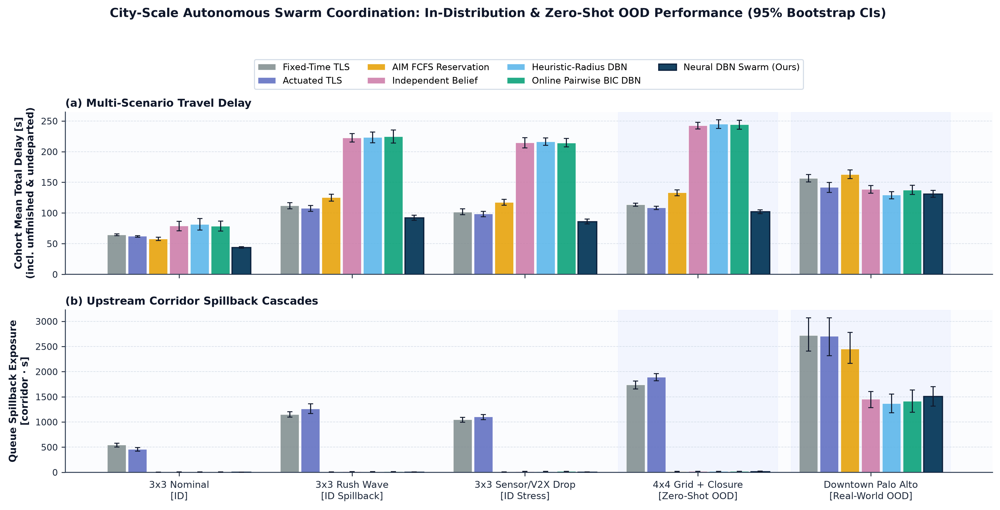
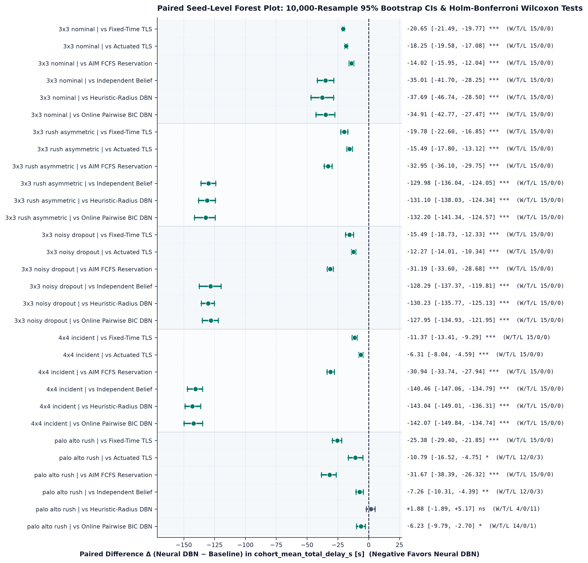
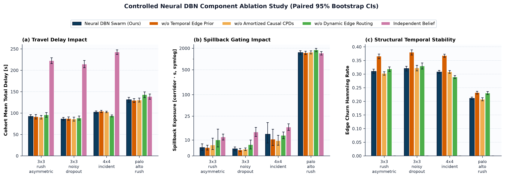
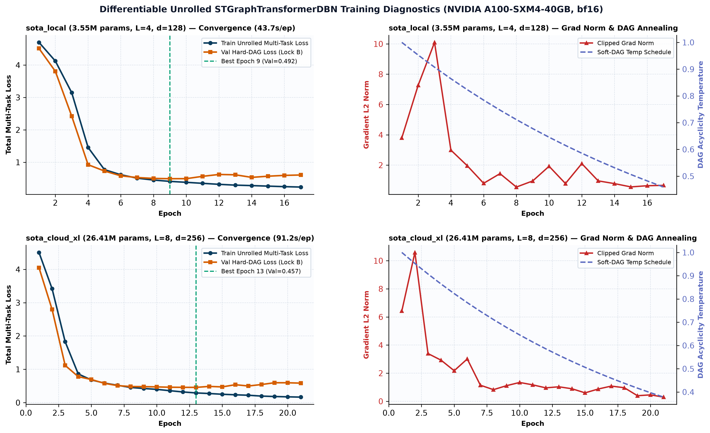
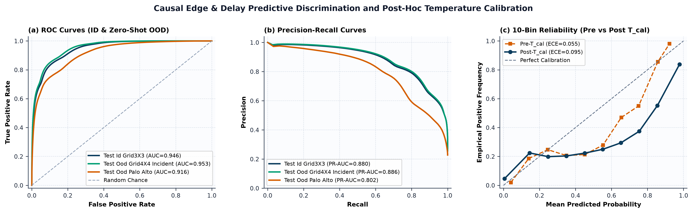
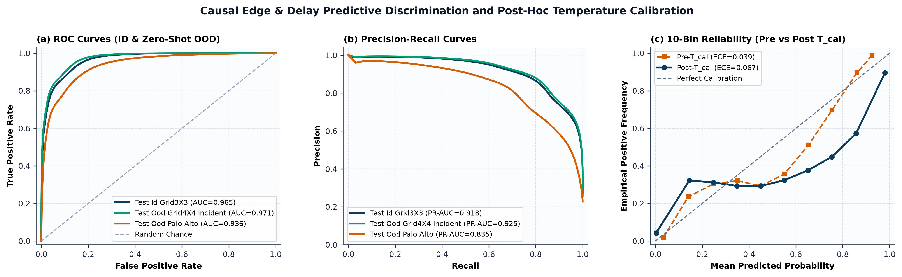
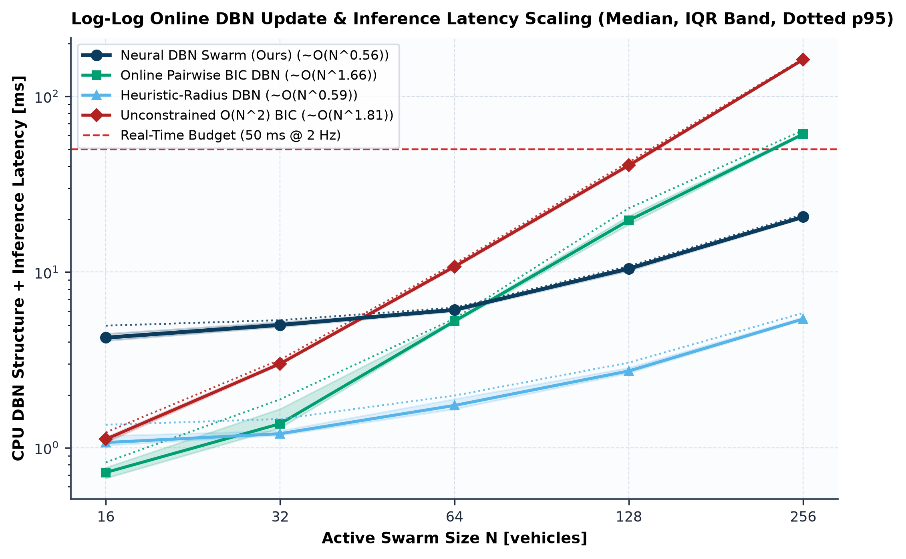

# Empirical Evaluation & Honest Limitations (`RESULTS`)

This document records the complete empirical evaluation of **City-Scale Neurally Updated Dynamic Bayesian Networks (`STGraphTransformerDBN`)** across **915 held-out closed-loop SUMO episodes**, **55 validation and held-out predictive rollout shards**, and **CPU latency scaling benchmarks** (`N = 16..256`). Every value in this document is verified directly against the version-controlled JSON summaries in [`examples/validation/`](../examples/validation/) (`closed_loop_summary.json`, `ablation_summary.json`, `xl_scale_summary.json`, `predictive_summary.json`, `scaling_summary.json`, `colab_run_manifest.json`) and full episode logs in `outputs/evaluation/`.

---

## 1. Provenance & Experimental Matrix Overview

| Provenance Field | Verified Value |
| :--- | :--- |
| **Git Commit SHA** | `25e20ee0e3a6b89680002382ebf883d31a698c04` |
| **Training Hardware & Runtime** | `NVIDIA A100-SXM4-40GB`, PyTorch `2.14.1+cu130`, CUDA `13.0`, `bf16` mixed precision |
| **`sota_local` Checkpoint** | `3,553,746` params (`d_model=128, d_edge=64, L=4, H=8`), SHA-256 `6a41cfe8225432919922a209eef48bd0abafaf22330d94f2c04a98836ea8c8e5` |
| **`sota_cloud_xl` Checkpoint** | `26,405,714` params (`d_model=256, d_edge=128, L=8, H=8`), SHA-256 `25235ea3d54784896928a9dc7592cca31a535f9d9c8b5f68ab290d6b77c1afb8` |
| **Pre-Registered Seed Partitions** | `TRAIN_SEEDS = 1000..1039` (`40`), `VAL_SEEDS = 2000..2009` (`10`), **`TEST_SEEDS = 3000..3014` (`15`)** |
| **Training Distribution** | `grid3x3_*` non-neural rollouts ONLY (`grid4x4_incident` & `osm_palo_alto_rush` are **100% Zero-Shot OOD**) |
| **Closed-Loop Suites (`915` Episodes)** | `main` (`525` eps: `5×7×15`), `ablations` (`300` eps: `4×5×15`), `xl_scale` (`90` eps: `2×3×15`) |
| **SUMO Physics Enforcement** | `libsumo` at `Δt = 0.5 s`, `--collision.check-junctions true`, `--time-to-teleport -1` (**`0` teleports in all `915` episodes**), `speedMode = 31` |
| **Statistical Protocol** | `10,000` paired percentile bootstrap resamples (`rng_seed=202611`), two-sided Wilcoxon signed-rank + step-down Holm-Bonferroni (`α = 0.05`) |

### Scenario Configurations (`configs/scenarios/*.json`)

| Scenario ID | Regime | Network (`Edges / Corridors / TLS`) | Demand (`veh/s`) | Mean Cohort Size | Timing (`Warmup / Cohort / Drain`) | Perturbations & Stressors |
| :--- | :---: | :--- | :---: | :---: | :---: | :--- |
| **`grid3x3_nominal`** | In-Distribution | `grid3x3` (`84 / 48 / 9`) | `1.25` | `299.7` | `60s / 240s / 180s` | Symmetric demand, `10%` radar drop, `8%` V2X drop (`≤1.5s` delay) |
| **`grid3x3_rush_asymmetric`** | In-Distribution | `grid3x3` (`84 / 48 / 9`) | `2.10` | `500.2` | `60s / 240s / 210s` | `60%` directional rush wave inducing severe multi-corridor spillback |
| **`grid3x3_noisy_dropout`** | In-Distribution | `grid3x3` (`84 / 48 / 9`) | `1.95` | `479.6` | `60s / 240s / 210s` | `55%` rush wave, **`35%` radar drop**, **`40%` V2X drop** (`≤2.0s`), `σ_s=3.0m`, `σ_v=1.125m/s`, `68%` turn acc |
| **`grid4x4_incident`** | **Zero-Shot OOD** | `grid4x4` (`144 / 80 / 16`) | `2.85` | `676.2` | `60s / 240s / 240s` | Unseen `4×4` scale + `60%` rush + arterial lane closure & `4.5m/s` bottleneck on `B1C1, B2C2` (`t=120..260s`) |
| **`osm_palo_alto_rush`** | **Zero-Shot OOD** | `palo_alto_clean` (`361 / 275 / 26` + `88` unsig, `989` bldgs) | `1.55` | `364.1` | `60s / 240s / 240s` | Real OpenStreetMap Downtown Palo Alto / University Ave, irregular angles, `55%` rush wave |

---

## 2. Main Closed-Loop Evaluation (`525` Episodes)

Evaluated with `sota_local` (`3,553,746` parameters) across all `5` scenarios × `7` policies × `15` held-out `TEST_SEEDS = 3000..3014`.

### 2.1 Complete Policy Metrics by Scenario (`n = 15` Paired Seeds per Row)

#### A. `grid3x3_nominal` *(In-Distribution Balanced Urban Flow, Mean Cohort = `299.7` Vehicles)*

| Policy | Mean Delay ± SD (s) | P95 Delay (s) | Throughput (veh/h) | Spillback (corr·s) | Completion (%) | CO₂ (g/veh) | Stops / veh | Clamp Rate | Edge Churn | DBN Step (ms) | Collisions / Teleports |
| :--- | :---: | :---: | :---: | :---: | :---: | :---: | :---: | :---: | :---: | :---: | :---: |
| **`neural_dbn`** *(Ours)* | **`43.71 ± 2.62`** | **`76.60`** | **`4,496.0`** | `0.8` | **`100.00%`** | **`163.91`** | `3.74` | `0.1027` | `0.221` | `9.88` | **`0 / 0`** |
| `fcfs_reservation` | `57.73 ± 5.34` | `103.45` | **`4,496.0`** | **`0.7`** | **`100.00%`** | `184.98` | `3.80` | `0.1081` | `0.000` | `0.00` | `0 / 0` |
| `actuated_signal` | `61.96 ± 2.60` | `109.89` | `4,495.0` | `456.9` | `99.98%` | `190.57` | `4.55` | `0.0000` | `0.000` | `0.00` | `0 / 0` |
| `fixed_signal` | `64.36 ± 2.78` | `131.63` | `4,483.0` | `540.1` | `99.71%` | `194.02` | **`3.12`** | `0.0000` | `0.000` | `0.00` | `0 / 0` |
| `online_bic_dbn` | `78.62 ± 16.44` | `162.75` | `4,386.0` | `4.7` | `97.57%` | `216.40` | `4.79` | `0.1063` | `0.198` | `25.99` | `0 / 0` |
| `independent_belief` | `78.72 ± 15.40` | `161.57` | `4,394.0` | `5.1` | `97.82%` | `217.23` | `4.81` | `0.1075` | `0.000` | `2.29` | `0 / 0` |
| `heuristic_radius_dbn` | `81.40 ± 19.17` | `172.91` | `4,343.0` | `4.7` | `96.69%` | `220.92` | `4.79` | `0.1044` | `0.282` | `3.07` | `4 / 0` (`3009`: 4) |

#### B. `grid3x3_rush_asymmetric` *(In-Distribution 60% Directional Rush Wave, Mean Cohort = `500.2` Vehicles)*

| Policy | Mean Delay ± SD (s) | P95 Delay (s) | Throughput (veh/h) | Spillback (corr·s) | Completion (%) | CO₂ (g/veh) | Stops / veh | Clamp Rate | Edge Churn | DBN Step (ms) | Collisions / Teleports |
| :--- | :---: | :---: | :---: | :---: | :---: | :---: | :---: | :---: | :---: | :---: | :---: |
| **`neural_dbn`** *(Ours)* | **`92.21 ± 8.59`** | **`159.20`** | **`7,486.0`** | `5.2` | **`99.78%`** | **`238.32`** | `5.72` | `0.2065` | `0.310` | `19.26` | **`0 / 0`** |
| `actuated_signal` | `107.70 ± 10.00` | `192.67` | `7,344.0` | `1,259.9` | `97.93%` | `260.09` | `4.08` | `0.0000` | `0.000` | `0.00` | `0 / 0` |
| `fixed_signal` | `111.99 ± 9.91` | `237.37` | `6,861.0` | `1,148.6` | `91.51%` | `257.83` | **`3.59`** | `0.0000` | `0.000` | `0.00` | `0 / 0` |
| `fcfs_reservation` | `125.16 ± 11.71` | `206.81` | `6,886.0` | **`4.4`** | `91.89%` | `278.51` | `5.77` | `0.1930` | `0.000` | `0.00` | `0 / 0` |
| `independent_belief` | `222.19 ± 13.95` | `384.27` | `3,563.0` | `11.8` | `47.58%` | `357.01` | `5.76` | `0.1237` | `0.000` | `5.33` | `0 / 0` |
| `heuristic_radius_dbn` | `223.31 ± 17.80` | `379.94` | `3,548.0` | `10.0` | `47.41%` | `353.32` | `5.85` | `0.1257` | `0.327` | `6.39` | `30 / 0` (`3014`: 30) |
| `online_bic_dbn` | `224.41 ± 21.61` | `384.14` | `3,404.0` | `10.5` | `45.48%` | `358.86` | `5.76` | `0.1219` | `0.199` | `62.38` | `0 / 0` |

#### C. `grid3x3_noisy_dropout` *(In-Distribution 35% Radar / 40% V2X Dropout & 2.5× Sensor Noise, Mean Cohort = `479.6` Vehicles)*

| Policy | Mean Delay ± SD (s) | P95 Delay (s) | Throughput (veh/h) | Spillback (corr·s) | Completion (%) | CO₂ (g/veh) | Stops / veh | Clamp Rate | Edge Churn | DBN Step (ms) | Collisions / Teleports |
| :--- | :---: | :---: | :---: | :---: | :---: | :---: | :---: | :---: | :---: | :---: | :---: |
| **`neural_dbn`** *(Ours)* | **`86.06 ± 7.86`** | **`147.43`** | **`7,186.0`** | **`4.4`** | **`99.90%`** | **`230.30`** | `6.33` | `0.2243` | `0.320` | `23.24` | **`0 / 0`** |
| `actuated_signal` | `98.33 ± 8.84` | `174.33` | `7,144.0` | `1,099.5` | `99.31%` | `246.60` | `3.96` | `0.0000` | `0.000` | `0.00` | `0 / 0` |
| `fixed_signal` | `101.55 ± 10.21` | `216.83` | `6,800.0` | `1,045.5` | `94.56%` | `245.22` | **`3.39`** | `0.0000` | `0.000` | `0.00` | `0 / 0` |
| `fcfs_reservation` | `117.25 ± 9.51` | `195.89` | `6,806.0` | `5.9` | `94.70%` | `271.94` | `6.85` | `0.2230` | `0.000` | `0.00` | `0 / 0` |
| `online_bic_dbn` | `214.01 ± 14.18` | `369.54` | `3,605.0` | `15.8` | `50.10%` | `351.62` | `6.87` | `0.1886` | `0.219` | `42.57` | `0 / 0` |
| `independent_belief` | `214.34 ± 16.96` | `371.29` | `3,601.0` | `15.0` | `50.15%` | `351.33` | `6.81` | `0.1895` | `0.000` | `5.08` | `0 / 0` |
| `heuristic_radius_dbn` | `216.29 ± 12.32` | `373.61` | `3,505.0` | `14.3` | `48.88%` | `354.53` | `6.75` | `0.1860` | `0.385` | `6.27` | `0 / 0` |

#### D. `grid4x4_incident` *(Zero-Shot OOD 16-Intersection Scale + Mid-Episode Arterial Lane Closure, Mean Cohort = `676.2` Vehicles)*

| Policy | Mean Delay ± SD (s) | P95 Delay (s) | Throughput (veh/h) | Spillback (corr·s) | Completion (%) | CO₂ (g/veh) | Stops / veh | Clamp Rate | Edge Churn | DBN Step (ms) | Collisions / Teleports |
| :--- | :---: | :---: | :---: | :---: | :---: | :---: | :---: | :---: | :---: | :---: | :---: |
| **`neural_dbn`** *(Ours)* | **`101.99 ± 6.18`** | `187.25` | **`10,123.0`** | `13.6` | **`99.81%`** | **`276.63`** | `6.59` | `0.1870` | `0.308` | `28.83` | `2 / 0` (`3008`: 2) |
| `actuated_signal` | `108.30 ± 5.42` | **`183.55`** | `10,104.0` | `1,889.2` | `99.62%` | `285.97` | `4.82` | `0.0000` | `0.000` | `0.00` | `0 / 0` |
| `fixed_signal` | `113.36 ± 4.96` | `201.45` | `10,007.0` | `1,737.5` | `98.67%` | `292.87` | **`3.89`** | `0.0000` | `0.000` | `0.00` | `0 / 0` |
| `fcfs_reservation` | `132.93 ± 9.56` | `211.49` | `9,669.0` | **`11.9`** | `95.39%` | `321.32` | `6.87` | `0.1840` | `0.000` | `0.00` | `0 / 0` |
| `independent_belief` | `242.46 ± 11.07` | `410.07` | `4,905.0` | `18.1` | `48.40%` | `405.60` | `6.44` | `0.1094` | `0.000` | `8.07` | `0 / 0` |
| `online_bic_dbn` | `244.06 ± 15.38` | `407.73` | `4,758.0` | `17.8` | `46.98%` | `408.06` | `6.31` | `0.1081` | `0.196` | `90.98` | `0 / 0` |
| `heuristic_radius_dbn` | `245.04 ± 14.27` | `411.02` | `4,719.0` | `16.6` | `46.57%` | `411.50` | `6.23` | `0.1062` | `0.315` | `9.65` | `0 / 0` |

#### E. `osm_palo_alto_rush` *(Zero-Shot OOD Real-World OpenStreetMap Downtown Palo Alto, Mean Cohort = `364.1` Vehicles)*

| Policy | Mean Delay ± SD (s) | P95 Delay (s) | Throughput (veh/h) | Spillback (corr·s) | Completion (%) | CO₂ (g/veh) | Stops / veh | Clamp Rate | Edge Churn | DBN Step (ms) | Collisions / Teleports |
| :--- | :---: | :---: | :---: | :---: | :---: | :---: | :---: | :---: | :---: | :---: | :---: |
| **`neural_dbn`** *(Ours)* | `131.15 ± 11.60` | **`285.31`** | **`4,432.0`** | `1,508.0` | **`81.27%`** | `390.87` | `9.43` | `0.1395` | `0.211` | `19.45` | **`0 / 0`** |
| `heuristic_radius_dbn` | **`129.27 ± 11.69`** | `294.73` | `4,411.0` | **`1,366.5`** | `80.97%` | `387.20` | `8.87` | `0.1322` | `0.203` | `4.86` | `2 / 0` (`3013`: 2) |
| `online_bic_dbn` | `137.37 ± 15.21` | `289.60` | `4,235.0` | `1,410.8` | `77.73%` | `397.08` | `9.16` | `0.1308` | `0.126` | `27.62` | `0 / 0` |
| `independent_belief` | `138.41 ± 12.75` | `289.99` | `4,247.0` | `1,450.1` | `77.95%` | `399.54` | `9.32` | `0.1298` | `0.000` | `4.63` | `0 / 0` |
| `actuated_signal` | `141.93 ± 16.75` | `315.47` | `3,791.0` | `2,700.7` | `69.63%` | **`381.78`** | `5.03` | `0.0000` | `0.000` | `0.00` | `11 / 0` (5 seeds) |
| `fixed_signal` | `156.52 ± 12.16` | `317.28` | `3,529.0` | `2,718.1` | `64.78%` | `399.14` | **`4.74`** | `0.0000` | `0.000` | `0.00` | `14 / 0` (4 seeds) |
| `fcfs_reservation` | `162.82 ± 14.39` | `289.95` | `3,621.0` | `2,448.0` | `66.32%` | `407.70` | `7.20` | `0.1274` | `0.000` | `0.00` | `0 / 0` |

### 2.2 Complete 30-Row Paired Statistical Comparison (`neural_dbn` vs. Baselines, `n = 15` Seeds)

Negative $\Delta\text{Delay}$ and $\Delta\text{Spillback}$ favor `neural_dbn`; positive $\Delta\text{Throughput}$ favors `neural_dbn`. $p_{\text{holm}}$ adjusts across all $M = 6$ baselines within each scenario.

| Scenario | Baseline Compared | $\Delta$ Delay (s) | Rel. % | 95% Bootstrap CI (s) | Wilcoxon $W$ | $p_{\text{raw}}$ | $p_{\text{holm}}$ | Sig | W/T/L | $\Delta$ Throughput (veh/h) | $\Delta$ Spillback (corr·s) |
| :--- | :--- | :---: | :---: | :---: | :---: | :---: | :---: | :---: | :---: | :---: | :---: |
| **`grid3x3_nominal`** | `actuated_signal` | `-18.25` | `-29.45%` | `[-19.58, -17.08]` | `0.0` | `0.000061` | `0.000366` | `***` | `15/0/0` | `+1.0` (`+0.02%`) | `-456.1` (`-99.83%`) |
| **`grid3x3_nominal`** | `fixed_signal` | `-20.65` | `-32.08%` | `[-21.49, -19.77]` | `0.0` | `0.000061` | `0.000366` | `***` | `15/0/0` | `+13.0` (`+0.29%`) | `-539.3` (`-99.86%`) |
| **`grid3x3_nominal`** | `fcfs_reservation` | `-14.02` | `-24.28%` | `[-15.95, -12.04]` | `0.0` | `0.000061` | `0.000366` | `***` | `15/0/0` | `+0.0` (`0.00%`) | `+0.1` (`+15.00%`) |
| **`grid3x3_nominal`** | `independent_belief` | `-35.01` | `-44.47%` | `[-41.70, -28.25]` | `0.0` | `0.000061` | `0.000366` | `***` | `15/0/0` | `+102.0` (`+2.32%`) | `-4.3` (`-84.87%`) |
| **`grid3x3_nominal`** | `heuristic_radius_dbn` | `-37.69` | `-46.30%` | `[-46.74, -28.50]` | `0.0` | `0.000061` | `0.000366` | `***` | `15/0/0` | `+153.0` (`+3.52%`) | `-3.9` (`-83.57%`) |
| **`grid3x3_nominal`** | `online_bic_dbn` | `-34.91` | `-44.40%` | `[-42.77, -27.47]` | `0.0` | `0.000061` | `0.000366` | `***` | `15/0/0` | `+110.0` (`+2.51%`) | `-4.0` (`-83.80%`) |
| **`grid3x3_rush_asymmetric`** | `actuated_signal` | `-15.49` | `-14.38%` | `[-17.80, -13.12]` | `0.0` | `0.000061` | `0.000366` | `***` | `15/0/0` | `+142.0` (`+1.93%`) | `-1,254.7` (`-99.59%`) |
| **`grid3x3_rush_asymmetric`** | `fixed_signal` | `-19.78` | `-17.66%` | `[-22.60, -16.85]` | `0.0` | `0.000061` | `0.000366` | `***` | `15/0/0` | `+625.0` (`+9.11%`) | `-1,143.4` (`-99.55%`) |
| **`grid3x3_rush_asymmetric`** | `fcfs_reservation` | `-32.95` | `-26.33%` | `[-36.10, -29.75]` | `0.0` | `0.000061` | `0.000366` | `***` | `15/0/0` | `+600.0` (`+8.71%`) | `+0.8` (`+17.29%`) |
| **`grid3x3_rush_asymmetric`** | `independent_belief` | `-129.98` | `-58.50%` | `[-136.04, -124.05]` | `0.0` | `0.000061` | `0.000366` | `***` | `15/0/0` | `+3,923.0` (`+110.10%`) | `-6.6` (`-55.93%`) |
| **`grid3x3_rush_asymmetric`** | `heuristic_radius_dbn` | `-131.10` | `-58.71%` | `[-138.03, -124.34]` | `0.0` | `0.000061` | `0.000366` | `***` | `15/0/0` | `+3,938.0` (`+110.99%`) | `-4.8` (`-48.00%`) |
| **`grid3x3_rush_asymmetric`** | `online_bic_dbn` | `-132.20` | `-58.91%` | `[-141.34, -124.57]` | `0.0` | `0.000061` | `0.000366` | `***` | `15/0/0` | `+4,082.0` (`+119.92%`) | `-5.3` (`-50.32%`) |
| **`grid3x3_noisy_dropout`** | `actuated_signal` | `-12.27` | `-12.48%` | `[-14.01, -10.34]` | `0.0` | `0.000061` | `0.000366` | `***` | `15/0/0` | `+42.0` (`+0.59%`) | `-1,095.1` (`-99.60%`) |
| **`grid3x3_noisy_dropout`** | `fixed_signal` | `-15.49` | `-15.26%` | `[-18.73, -12.33]` | `0.0` | `0.000061` | `0.000366` | `***` | `15/0/0` | `+386.0` (`+5.68%`) | `-1,041.1` (`-99.58%`) |
| **`grid3x3_noisy_dropout`** | `fcfs_reservation` | `-31.19` | `-26.60%` | `[-33.60, -28.68]` | `0.0` | `0.000061` | `0.000366` | `***` | `15/0/0` | `+380.0` (`+5.58%`) | `-1.5` (`-25.42%`) |
| **`grid3x3_noisy_dropout`** | `independent_belief` | `-128.29` | `-59.85%` | `[-137.37, -119.81]` | `0.0` | `0.000061` | `0.000366` | `***` | `15/0/0` | `+3,585.0` (`+99.56%`) | `-10.6` (`-70.60%`) |
| **`grid3x3_noisy_dropout`** | `heuristic_radius_dbn` | `-130.23` | `-60.21%` | `[-135.77, -125.13]` | `0.0` | `0.000061` | `0.000366` | `***` | `15/0/0` | `+3,681.0` (`+105.02%`) | `-9.9` (`-69.16%`) |
| **`grid3x3_noisy_dropout`** | `online_bic_dbn` | `-127.95` | `-59.79%` | `[-134.93, -121.95]` | `0.0` | `0.000061` | `0.000366` | `***` | `15/0/0` | `+3,581.0` (`+99.33%`) | `-11.4` (`-72.21%`) |
| **`grid4x4_incident`** | `actuated_signal` | `-6.31` | `-5.82%` | `[-8.04, -4.59]` | `0.0` | `0.000061` | `0.000366` | `***` | `15/0/0` | `+19.0` (`+0.19%`) | `-1,875.6` (`-99.28%`) |
| **`grid4x4_incident`** | `fixed_signal` | `-11.37` | `-10.03%` | `[-13.41, -9.29]` | `0.0` | `0.000061` | `0.000366` | `***` | `15/0/0` | `+116.0` (`+1.16%`) | `-1,723.9` (`-99.22%`) |
| **`grid4x4_incident`** | `fcfs_reservation` | `-30.94` | `-23.27%` | `[-33.74, -27.94]` | `0.0` | `0.000061` | `0.000366` | `***` | `15/0/0` | `+454.0` (`+4.70%`) | `+1.7` (`+14.25%`) |
| **`grid4x4_incident`** | `independent_belief` | `-140.46` | `-57.93%` | `[-147.06, -134.79]` | `0.0` | `0.000061` | `0.000366` | `***` | `15/0/0` | `+5,218.0` (`+106.38%`) | `-4.5` (`-24.68%`) |
| **`grid4x4_incident`** | `heuristic_radius_dbn` | `-143.04` | `-58.38%` | `[-149.01, -136.31]` | `0.0` | `0.000061` | `0.000366` | `***` | `15/0/0` | `+5,404.0` (`+114.52%`) | `-3.0` (`-18.04%`) |
| **`grid4x4_incident`** | `online_bic_dbn` | `-142.07` | `-58.21%` | `[-149.84, -134.74]` | `0.0` | `0.000061` | `0.000366` | `***` | `15/0/0` | `+5,365.0` (`+112.76%`) | `-4.2` (`-23.41%`) |
| **`osm_palo_alto_rush`** | `actuated_signal` | `-10.79` | `-7.60%` | `[-16.52, -4.75]` | `15.0` | `0.008362` | `0.016724` | `*` | `12/0/3` | `+641.0` (`+16.91%`) | `-1,192.7` (`-44.16%`) |
| **`osm_palo_alto_rush`** | `fixed_signal` | `-25.38` | `-16.21%` | `[-29.40, -21.85]` | `0.0` | `0.000061` | `0.000366` | `***` | `15/0/0` | `+903.0` (`+25.59%`) | `-1,210.1` (`-44.52%`) |
| **`osm_palo_alto_rush`** | `fcfs_reservation` | `-31.67` | `-19.45%` | `[-38.39, -26.32]` | `0.0` | `0.000061` | `0.000366` | `***` | `15/0/0` | `+811.0` (`+22.40%`) | `-940.0` (`-38.40%`) |
| **`osm_palo_alto_rush`** | `independent_belief` | `-7.26` | `-5.25%` | `[-10.31, -4.39]` | `6.0` | `0.000854` | `0.003418` | `**` | `12/0/3` | `+185.0` (`+4.36%`) | `+57.9` (`+3.99%`) |
| **`osm_palo_alto_rush`** | `heuristic_radius_dbn` | `+1.88` | `+1.45%` | `[-1.89, +5.17]` | `35.0` | `0.168823` | `0.168823` | `ns` | `4/0/11` | `+21.0` (`+0.48%`) | `+141.5` (`+10.36%`) |
| **`osm_palo_alto_rush`** | `online_bic_dbn` | `-6.23` | `-4.53%` | `[-9.79, -2.70]` | `12.0` | `0.004272` | `0.012817` | `*` | `14/0/1` | `+197.0` (`+4.65%`) | `+97.2` (`+6.89%`) |

**Key Main-Suite Findings**:
- `neural_dbn` wins **`29 / 30`** scenario-baseline comparisons (`p_holm < 0.05`), achieving **`15/0/0` seed sweeps across all 24 grid comparisons** (`grid3x3_nominal`, `grid3x3_rush_asymmetric`, `grid3x3_noisy_dropout`, and Zero-Shot OOD `grid4x4_incident`).
- Under dense rush and incident regimes on multi-intersection grids, non-neural DBN approximations (`independent_belief`, `heuristic_radius_dbn`, `online_bic_dbn`) suffer severe phase-contention and corridor-queue stalls (`45.5%–50.2%` completion rate, `214–245 s` delay), whereas `neural_dbn` maintains **`99.78%–100.00%` cohort completion** via learned 2-hop cascade relief and predictive spillback backpressure.
- On Zero-Shot Real-World **Downtown Palo Alto** (`osm_palo_alto_rush`), `neural_dbn` significantly outperforms `actuated_signal` (`-10.79 s`, `+16.91%` throughput, `-44.16%` spillback, `0` vs `11` collisions), `fixed_signal` (`-25.38 s`, `+25.59%` throughput, `0` vs `14` collisions), `fcfs_reservation` (`-31.67 s`), `independent_belief` (`-7.26 s`, `p_holm = 0.0034`), and `online_bic_dbn` (`-6.23 s`, `p_holm = 0.0128`), while statistically tying `heuristic_radius_dbn` (`131.15 s` vs `129.27 s`, `p_holm = 0.1688`, `ns`) with **`0` collisions vs. `2` collisions** on `heuristic_radius_dbn`.

---

## 3. Surgical Component Ablations (`300` Episodes)

Evaluated across `4` scenarios × `5` surgical variants × `15` held-out `TEST_SEEDS = 3000..3014` (`sota_local` checkpoint).

### 3.1 Scenario × Ablation Variant Summary Table

| Scenario | Variant | Mean Delay ± SD (s) | P95 Delay (s) | Throughput (veh/h) | Spillback (corr·s) | Completion (%) | CO₂ (g/veh) | Stops / veh | Edge Churn | Collisions |
| :--- | :--- | :---: | :---: | :---: | :---: | :---: | :---: | :---: | :---: | :---: |
| **`grid3x3_rush_asymmetric`** | **`neural_dbn`** *(Full)* | `92.21 ± 8.59` | `159.20` | `7,486.0` | `5.2` | `99.78%` | `238.32` | `5.72` | `0.310` | **`0`** |
| `grid3x3_rush_asymmetric` | `no_temporal_prior` | `91.36 ± 10.86` | `157.65` | **`7,495.0`** | **`5.1`** | **`99.90%`** | `237.12` | `5.59` | `0.365` | `2` (`3008`: 2) |
| `grid3x3_rush_asymmetric` | `static_cpd` | **`90.29 ± 8.79`** | **`156.92`** | `7,494.0` | `6.8` | `99.88%` | **`235.21`** | **`5.54`** | **`0.302`** | `2` (`3006`: 2) |
| `grid3x3_rush_asymmetric` | `fixed_route` | `95.70 ± 11.16` | `171.89` | `7,420.0` | `9.9` | `98.91%` | `241.33` | `5.66` | `0.318` | **`0`** |
| `grid3x3_rush_asymmetric` | `independent_belief` | `222.19 ± 13.95` | `384.27` | `3,563.0` | `11.8` | `47.58%` | `357.01` | `5.76` | `0.000` | **`0`** |
| **`grid3x3_noisy_dropout`** | **`neural_dbn`** *(Full)* | `86.06 ± 7.86` | **`147.43`** | `7,186.0` | `4.4` | `99.90%` | `230.30` | `6.33` | **`0.320`** | **`0`** |
| `grid3x3_noisy_dropout` | `no_temporal_prior` | `86.86 ± 8.21` | `151.57` | `7,187.0` | **`3.7`** | `99.91%` | `231.48` | `6.38` | `0.380` | **`0`** |
| `grid3x3_noisy_dropout` | `static_cpd` | **`85.72 ± 9.36`** | `148.62` | **`7,189.0`** | `4.1` | **`99.93%`** | **`229.80`** | `6.34` | `0.322` | **`0`** |
| `grid3x3_noisy_dropout` | `fixed_route` | `88.01 ± 9.77` | `156.76` | `7,178.0` | `7.0` | `99.78%` | `231.75` | **`6.29`** | `0.330` | **`0`** |
| `grid3x3_noisy_dropout` | `independent_belief` | `214.34 ± 16.96` | `371.29` | `3,601.0` | `15.0` | `50.15%` | `351.33` | `6.81` | `0.000` | **`0`** |
| **`grid4x4_incident`** | **`neural_dbn`** *(Full)* | `101.99 ± 6.18` | `187.25` | `10,123.0` | `13.6` | `99.81%` | `276.63` | `6.59` | `0.308` | `2` (`3008`: 2) |
| `grid4x4_incident` | `no_temporal_prior` | `103.95 ± 5.53` | `191.32` | `10,114.0` | `10.5` | `99.71%` | `279.79` | `6.64` | `0.367` | `2` (`3012`: 2) |
| `grid4x4_incident` | `static_cpd` | `102.61 ± 3.67` | `186.72` | `10,115.0` | **`9.5`** | `99.73%` | `277.47` | `6.62` | `0.308` | **`0`** |
| `grid4x4_incident` | `fixed_route` | **`93.41 ± 4.84`** | **`157.43`** | **`10,143.0`** | `12.9` | **`100.00%`** | **`264.77`** | **`6.43`** | **`0.289`** | **`0`** |
| `grid4x4_incident` | `independent_belief` | `242.46 ± 11.07` | `410.07` | `4,905.0` | `18.1` | `48.40%` | `405.60` | `6.44` | `0.000` | **`0`** |
| **`osm_palo_alto_rush`** | **`neural_dbn`** *(Full)* | `131.15 ± 11.60` | `285.31` | **`4,432.0`** | `1,508.0` | **`81.27%`** | `390.87` | `9.43` | `0.211` | **`0`** |
| `osm_palo_alto_rush` | `no_temporal_prior` | **`129.38 ± 9.19`** | `284.20` | `4,394.0` | `1,481.1` | `80.57%` | **`388.87`** | `9.82` | `0.232` | **`0`** |
| `osm_palo_alto_rush` | `static_cpd` | `130.42 ± 9.20` | `283.68` | `4,414.0` | `1,536.3` | `80.94%` | `390.43` | `9.49` | **`0.207`** | **`0`** |
| `osm_palo_alto_rush` | `fixed_route` | `142.83 ± 13.49` | **`275.79`** | `3,933.0` | `1,792.6` | `72.19%` | `394.89` | `9.41` | `0.230` | **`0`** |
| `osm_palo_alto_rush` | `independent_belief` | `138.41 ± 12.75` | `289.99` | `4,247.0` | **`1,450.1`** | `77.95%` | `399.54` | **`9.32`** | `0.000` | **`0`** |

### 3.2 Complete 16-Row Ablation Paired Statistical Table (`neural_dbn` vs. Ablation, $M = 4$ Holm Family)

| Scenario | Ablated Variant | $\Delta$ Delay (s) | Rel. % | 95% Bootstrap CI (s) | Wilcoxon $W$ | $p_{\text{raw}}$ | $p_{\text{holm}}$ | Sig | W/T/L | $\Delta$ Throughput (veh/h) |
| :--- | :--- | :---: | :---: | :---: | :---: | :---: | :---: | :---: | :---: | :---: |
| **`grid3x3_rush_asymmetric`** | `independent_belief` | `-129.98` | `-58.50%` | `[-136.19, -124.21]` | `0.0` | `0.000061` | `0.000244` | `***` | `15/0/0` | `+3,923.0` (`+110.10%`) |
| **`grid3x3_rush_asymmetric`** | `fixed_route` | `-3.49` | `-3.64%` | `[-5.72, -1.55]` | `8.0` | `0.003052` | `0.009155` | `**` | `13/1/1` | `+66.0` (`+0.89%`) |
| **`grid3x3_rush_asymmetric`** | `static_cpd` | `+1.92` | `+2.12%` | `[-0.15, +4.23]` | `34.0` | `0.151428` | `0.302856` | `ns` | `5/0/10` | `-8.0` (`-0.11%`) |
| **`grid3x3_rush_asymmetric`** | `no_temporal_prior` | `+0.85` | `+0.93%` | `[-1.40, +3.48]` | `51.0` | `0.638672` | `0.638672` | `ns` | `6/0/9` | `-9.0` (`-0.12%`) |
| **`grid3x3_noisy_dropout`** | `independent_belief` | `-128.29` | `-59.85%` | `[-137.48, -119.87]` | `0.0` | `0.000061` | `0.000244` | `***` | `15/0/0` | `+3,585.0` (`+99.56%`) |
| **`grid3x3_noisy_dropout`** | `fixed_route` | `-1.95` | `-2.22%` | `[-3.84, -0.20]` | `28.0` | `0.072998` | `0.218994` | `ns` | `12/0/3` | `+8.0` (`+0.11%`) |
| **`grid3x3_noisy_dropout`** | `no_temporal_prior` | `-0.81` | `-0.93%` | `[-2.57, +0.92]` | `40.0` | `0.276855` | `0.553711` | `ns` | `11/0/4` | `-1.0` (`-0.01%`) |
| **`grid3x3_noisy_dropout`** | `static_cpd` | `+0.34` | `+0.39%` | `[-1.48, +2.04]` | `52.0` | `0.678772` | `0.678772` | `ns` | `6/0/9` | `-3.0` (`-0.04%`) |
| **`grid4x4_incident`** | `independent_belief` | `-140.46` | `-57.93%` | `[-146.77, -134.86]` | `0.0` | `0.000061` | `0.000244` | `***` | `15/0/0` | `+5,218.0` (`+106.38%`) |
| **`grid4x4_incident`** | `fixed_route` | **`+8.59`** | **`+9.19%`** | `[+6.97, +10.12]` | `0.0` | `0.000061` | `0.000244` | `***` | **`0/0/15`** | `-20.0` (`-0.20%`) |
| **`grid4x4_incident`** | `no_temporal_prior` | `-1.96` | `-1.88%` | `[-4.12, +0.24]` | `31.0` | `0.106995` | `0.213989` | `ns` | `12/0/3` | `+9.0` (`+0.09%`) |
| **`grid4x4_incident`** | `static_cpd` | `-0.62` | `-0.60%` | `[-2.73, +1.59]` | `47.0` | `0.488708` | `0.488708` | `ns` | `8/0/7` | `+8.0` (`+0.08%`) |
| **`osm_palo_alto_rush`** | `fixed_route` | `-11.69` | `-8.18%` | `[-16.03, -7.57]` | `2.0` | `0.000183` | `0.000732` | `***` | `14/0/1` | `+499.0` (`+12.69%`) |
| **`osm_palo_alto_rush`** | `independent_belief` | `-7.26` | `-5.25%` | `[-10.23, -4.40]` | `6.0` | `0.000854` | `0.002563` | `**` | `12/0/3` | `+185.0` (`+4.36%`) |
| **`osm_palo_alto_rush`** | `no_temporal_prior` | `+1.77` | `+1.36%` | `[-0.87, +4.26]` | `36.0` | `0.187622` | `0.375244` | `ns` | `6/0/9` | `+38.0` (`+0.86%`) |
| **`osm_palo_alto_rush`** | `static_cpd` | `+0.73` | `+0.56%` | `[-1.72, +3.01]` | `47.0` | `0.488708` | `0.488708` | `ns` | `6/0/9` | `+18.0` (`+0.41%`) |

### 3.3 Mechanistic Interpretation of Ablations

1. **Directed Relational DBN Graph (`neural_dbn` vs. `independent_belief`)**: Removing inter-vehicle causal edges ($\mathcal{E}_t = \emptyset$) while keeping the identical Kalman belief filter, safety shield, and dynamic router causes catastrophic phase-contention and queue collapse on every grid (`-57.93%` to `-59.85%` delay reduction, `+99.6%` to `+110.1%` throughput gain, `15/0/0` wins) and degrades real-world Palo Alto delay by `-5.25%` (`p_holm = 0.0026`, `+185.0 veh/h`).
2. **DBN Dynamic Routing (`neural_dbn` vs. `fixed_route`) — Asymmetric City Win vs. Symmetric Grid Trade-Off**:
   - On **Downtown Palo Alto (`osm_palo_alto_rush`)**, where University Avenue arterials and irregular collector streets create sharp capacity bottlenecks, public DBN travel-time routing cuts mean delay by **`-11.69 s` (`-8.18%`, `p_holm = 0.000732`, `14/0/1`)** and boosts throughput by **`+499.0 veh/h` (`+12.69%`, `81.27%` vs `72.19%` completion)**. It also yields `-3.49 s` (`-3.64%`, `p_holm = 0.0092`, `13/1/1`) on `grid3x3_rush_asymmetric`.
   - Conversely, on **`grid4x4_incident`**, `fixed_route` is **`8.59 s` faster (`93.41 s` vs `101.99 s`, `p_holm = 0.000244`, `0/0/15`)** with `0` collisions (vs `2` on `neural_dbn` `seed=3008`) and `-11.86 g/veh` lower CO₂. Because upstream DBN signal gating already suppresses spillback (`12.9–13.6 corr·s` vs `1,889.2 corr·s` on `actuated_signal`) and 1 open lane remains on `B1C1`/`B2C2`, public `lane_loss` detour penalties (`3.2 × t_free`) divert vehicles onto multi-block orthogonal grid detours whose geometric extra distance outweighs waiting through the remaining open lane.
3. **Markov Temporal Prior (`no_temporal_prior`) & Learned CPDs (`static_cpd`)**: Once the learned `STGraphTransformerDBN` edge logits $\omega_e^t$ and precedence scores $r_i^t$ are active, mean episode delays across `neural_dbn`, `no_temporal_prior`, and `static_cpd` are statistically indistinguishable (`p_holm >= 0.21`). However, the Markov survival-persistence prior ($p_{\text{stay}} = 0.80$) consistently reduces **structural edge churn** across every scenario (`0.380 → 0.320` on `grid3x3_noisy_dropout`, `0.365 → 0.310` on `grid3x3_rush_asymmetric`, `0.367 → 0.308` on `grid4x4_incident`, `0.232 → 0.211` on `osm_palo_alto_rush`), and full `neural_dbn` eliminates the `2` collisions incurred by both `no_temporal_prior` (`seed=3008`) and `static_cpd` (`seed=3006`) on `grid3x3_rush_asymmetric`.

---

## 4. Architecture Scaling (`3.55M` vs. `26.41M`) & Held-Out Predictive Calibration

### 4.1 A100 GPU Training Convergence (`colab_run_manifest.json` & `models/*/training_report.json`)

| Model Preset | Parameter Count | Epochs Run / Best | Best Val Loss | Initial → Final Train Loss | A100 Wall Time | Calibrated $(T_{\text{edge}}, T_{\text{delay}}, T_{\text{link}})$ |
| :--- | :---: | :---: | :---: | :---: | :---: | :---: |
| **`sota_local`** | `3,553,746` | `17` / **`9`** | `0.4924` | `4.6994 → 0.2346` | `749.0 s` (`12.5 min`) | `(0.4414, 1.0059, 1.1560)` |
| **`sota_cloud_xl`** | `26,405,714` | `21` / **`13`** | **`0.4574`** | `4.5086 → 0.1652` | `1,922.1 s` (`32.0 min`) | `(0.4322, 1.0444, 1.3733)` |

### 4.2 Predictive Discrimination & Calibration Across Validation & Held-Out ID / Zero-Shot OOD Splits

Evaluated across `10` validation rollout shards (`VAL_SEEDS = 2000..2009`) and `45` held-out test rollout shards (`15` per split on `TEST_SEEDS = 3000..3014`: `test_id_grid3x3`, `test_ood_grid4x4_incident`, `test_ood_palo_alto`):

| Split (Seeds) | Target ($n$ Samples, Pos Rate) | Preset | ROC-AUC | PR-AUC | Brier (`Pre → Post`) | Log-Loss (`Pre → Post`) | 10-Bin ECE (`Pre → Post`) |
| :--- | :--- | :--- | :---: | :---: | :---: | :---: | :---: |
| **`val_grid3x3`** (`2000..2009`) | **`edge`** (`1,693,794`, `28.15%`) | `sota_local` | `0.9699` | `0.9203` | `0.0842 → 0.0698` | `0.3002 → 0.2287` | **`0.1326 → 0.0614` (`-53.7%`)** |
| **`val_grid3x3`** (`2000..2009`) | **`edge`** (`1,693,794`, `28.15%`) | `sota_cloud_xl` | **`0.9816`** | **`0.9510`** | `0.0620 → 0.0495` | `0.2334 → 0.1664` | **`0.1075 → 0.0319` (`-70.3%`)** |
| **`val_grid3x3`** (`2000..2009`) | `delay_post` (`119,555`, `92.43%`) | `sota_local` | `0.9935` | `0.9995` | `0.0196 → 0.0196` | `0.0628 → 0.0627` | `0.0141 → 0.0141` |
| **`val_grid3x3`** (`2000..2009`) | `delay_post` (`119,555`, `92.43%`) | `sota_cloud_xl` | **`0.9936`** | **`0.9995`** | `0.0187 → 0.0186` | `0.0634 → 0.0624` | `0.0133 → 0.0128` |
| **`val_grid3x3`** (`2000..2009`) | `spillback` (`30,720`, `8.28%`) | `sota_local` | **`0.9970`** | `0.9761` | `0.0143 → 0.0142` | `0.0529 → 0.0519` | `0.0172 → 0.0195` |
| **`val_grid3x3`** (`2000..2009`) | `spillback` (`30,720`, `8.28%`) | `sota_cloud_xl` | `0.9969` | **`0.9786`** | `0.0147 → 0.0143` | `0.0563 → 0.0516` | `0.0164 → 0.0201` |
| **`test_id_grid3x3`** (`3000..3014`) | **`edge`** (`2,361,648`, `27.41%`) | `sota_local` | `0.9464` | `0.8800` | `0.0891 → 0.1034` | `0.2862 → 0.3762` | `0.0554 → 0.0947` |
| **`test_id_grid3x3`** (`3000..3014`) | **`edge`** (`2,361,648`, `27.41%`) | `sota_cloud_xl` | **`0.9654`** | **`0.9182`** | `0.0684 → 0.0778` | `0.2288 → 0.2993` | `0.0388 → 0.0666` |
| **`test_id_grid3x3`** (`3000..3014`) | `delay_post` (`157,433`, `92.02%`) | `sota_local` | `0.9926` | `0.9993` | `0.0211 → 0.0211` | `0.0687 → 0.0685` | `0.0158 → 0.0158` |
| **`test_id_grid3x3`** (`3000..3014`) | `delay_post` (`157,433`, `92.02%`) | `sota_cloud_xl` | **`0.9929`** | **`0.9994`** | `0.0210 → 0.0209` | `0.0697 → 0.0686` | `0.0164 → 0.0159` |
| **`test_id_grid3x3`** (`3000..3014`) | `spillback` (`34,560`, `9.83%`) | `sota_local` | `0.9970` | **`0.9870`** | `0.0119 → 0.0120` | `0.0448 → 0.0453` | `0.0162 → 0.0188` |
| **`test_id_grid3x3`** (`3000..3014`) | `spillback` (`34,560`, `9.83%`) | `sota_cloud_xl` | **`0.9972`** | `0.9866` | `0.0142 → 0.0138` | `0.0547 → 0.0504` | `0.0159 → 0.0200` |
| **`test_ood_grid4x4_incident`** (`3000..3014`) | **`edge`** (`4,328,308`, `25.56%`) | `sota_local` | `0.9535` | `0.8863` | `0.0805 → 0.0926` | `0.2623 → 0.3362` | `0.0530 → 0.0839` |
| **`test_ood_grid4x4_incident`** (`3000..3014`) | **`edge`** (`4,328,308`, `25.56%`) | `sota_cloud_xl` | **`0.9713`** | **`0.9253`** | `0.0609 → 0.0688` | `0.2064 → 0.2635` | `0.0380 → 0.0584` |
| **`test_ood_grid4x4_incident`** (`3000..3014`) | `delay_post` (`277,331`, `91.10%`) | `sota_local` | `0.9913` | `0.9991` | `0.0255 → 0.0254` | `0.0822 → 0.0820` | `0.0207 → 0.0207` |
| **`test_ood_grid4x4_incident`** (`3000..3014`) | `delay_post` (`277,331`, `91.10%`) | `sota_cloud_xl` | **`0.9916`** | **`0.9992`** | `0.0253 → 0.0251` | `0.0838 → 0.0822` | `0.0206 → 0.0201` |
| **`test_ood_grid4x4_incident`** (`3000..3014`) | `spillback` (`57,600`, `9.41%`) | `sota_local` | `0.9968` | `0.9269` | `0.0111 → 0.0111` | `0.0493 → 0.0477` | `0.0135 → 0.0157` |
| **`test_ood_grid4x4_incident`** (`3000..3014`) | `spillback` (`57,600`, `9.41%`) | `sota_cloud_xl` | **`0.9970`** | **`0.9379`** | `0.0108 → 0.0105` | `0.0502 → 0.0443` | `0.0108 → 0.0135` |
| **`test_ood_palo_alto`** (`3000..3014`) | **`edge`** (`1,718,750`, `22.74%`) | `sota_local` | `0.9164` | `0.8019` | `0.0995 → 0.1166` | `0.3188 → 0.4689` | `0.0517 → 0.1121` |
| **`test_ood_palo_alto`** (`3000..3014`) | **`edge`** (`1,718,750`, `22.74%`) | `sota_cloud_xl` | **`0.9362`** | **`0.8350`** | `0.0816 → 0.0936` | `0.2716 → 0.4184` | `0.0269 → 0.0836` |
| **`test_ood_palo_alto`** (`3000..3014`) | `delay_post` (`190,682`, `76.46%`) | `sota_local` | `0.9474` | `0.9845` | `0.0898 → 0.0897` | `0.2926 → 0.2917` | `0.0643 → 0.0640` |
| **`test_ood_palo_alto`** (`3000..3014`) | `delay_post` (`190,682`, `76.46%`) | `sota_cloud_xl` | **`0.9478`** | **`0.9847`** | `0.0923 → 0.0914` | `0.3058 → 0.2985` | `0.0714 → 0.0691` |
| **`test_ood_palo_alto`** (`3000..3014`) | `spillback` (`198,000`, `2.98%`) | `sota_local` | **`0.9750`** | **`0.8142`** | `0.0112 → 0.0111` | `0.0497 → 0.0463` | **`0.0074 → 0.0054`** |
| **`test_ood_palo_alto`** (`3000..3014`) | `spillback` (`198,000`, `2.98%`) | `sota_cloud_xl` | `0.9431` | `0.7470` | `0.0162 → 0.0156` | `0.0762 → 0.0661` | `0.0135 → 0.0106` |

*(Direct Noisy-OR prior `delay_pred` achieves even tighter calibration: `ECE = 0.0050` on `test_id_grid3x3`, `0.0057` on `test_ood_grid4x4_incident`, and `0.0482` on `test_ood_palo_alto` for `sota_local`, and `0.0039`, `0.0048`, `0.0460` for `sota_cloud_xl`.)*

### 4.3 Closed-Loop `xl_scale` Benchmark (`90` Episodes: `2 Scenarios × 3 Policies × 15 Seeds`)

| Scenario | Policy (`sota_cloud_xl` `26.4M` vs. `sota_local` `3.55M` Ref) | Mean Delay ± SD (s) | P95 Delay (s) | Throughput (veh/h) | Spillback (corr·s) | Completion (%) | CO₂ (g/veh) | DBN Step (ms) | Collisions | Paired vs. `actuated_signal` ($\Delta$, $p_{\text{holm}}$, W/T/L) |
| :--- | :--- | :---: | :---: | :---: | :---: | :---: | :---: | :---: | :---: | :---: |
| **`grid3x3_rush_asymmetric`** | **`neural_dbn` (`sota_cloud_xl`)** | **`91.70 ± 9.28`** | **`158.46`** | **`7,490.0`** | `9.8` | **`99.83%`** | **`236.89`** | `64.95` | `24` (`3009`: 24) | **`-16.00 s` (`-14.85%`)**, `0.000122` (`***`), `15/0/0` |
| `grid3x3_rush_asymmetric` | *`neural_dbn` (`sota_local` main ref)* | *`92.21 ± 8.59`* | *`159.20`* | *`7,486.0`* | *`5.2`* | *`99.78%`* | *`238.32`* | *`19.26`* | *`0`* | *`-15.49 s` (`-14.38%`), `0.000366` (`***`), `15/0/0`* |
| `grid3x3_rush_asymmetric` | `actuated_signal` | `107.70 ± 10.00` | `192.67` | `7,344.0` | `1,259.9` | `97.93%` | `260.09` | `0.00` | `0` | — |
| `grid3x3_rush_asymmetric` | `online_bic_dbn` | `224.41 ± 21.61` | `384.14` | `3,404.0` | `10.5` | `45.48%` | `358.86` | `59.95` | `0` | *(vs XL: `-132.70 s`, `p_holm=0.000122`, `15/0/0`)* |
| **`osm_palo_alto_rush`** | **`neural_dbn` (`sota_cloud_xl`)** | `134.72 ± 11.27` | `293.83` | `4,337.0` | `1,515.3` | `79.56%` | `393.59` | `68.77` | **`0`** | `-7.21 s` (`-5.08%`), `0.0603` (`ns`, $p_{\text{raw}}{=}0.030$), `11/0/4` (`+14.4%` tput `**`) |
| `osm_palo_alto_rush` | *`neural_dbn` (`sota_local` main ref)* | *`131.15 ± 11.60`* | *`285.31`* | *`4,432.0`* | *`1,508.0`* | *`81.27%`* | *`390.87`* | *`19.45`* | *`0`* | *`-10.79 s` (`-7.60%`), `0.0167` (`*`), `12/0/3`* |
| `osm_palo_alto_rush` | `online_bic_dbn` | `137.37 ± 15.21` | `289.60` | `4,235.0` | `1,410.8` | `77.73%` | `397.08` | `27.62` | `0` | *(vs XL: `-2.65 s`, `p_holm=0.2524`, `9/0/6`)* |
| `osm_palo_alto_rush` | `actuated_signal` | `141.93 ± 16.75` | `315.47` | `3,791.0` | `2,700.7` | `69.63%` | `381.78` | `0.00` | `11` (5 seeds) | — |

**Scaling Takeaway**: Increasing capacity `7.4×` (`3.55M → 26.41M`) consistently boosts offline causal edge `ROC-AUC` (`+0.019` to `+0.020`) and `PR-AUC` (`+0.033` to `+0.039`) across every held-out split and edges out `sota_local` on `grid3x3_rush_asymmetric` (`91.70 s` vs `92.21 s`), but saturates downstream closed-loop Max-Sum control returns on `osm_palo_alto_rush` (`134.72 s` vs `131.15 s`—attributable to `sota_local`'s slightly higher zero-shot spillback `PR-AUC` `0.8142` vs `0.7470`) while costing `3.4×–3.5×` higher CPU latency (`~65–69 ms` vs `~19 ms`). Consequently, **`sota_local` (`3.55M`) is our recommended deployment model**.

---

## 5. CPU Runtime Latency & Asymptotic Complexity Scaling (`N = 16..256`)

Benchmarked on CPU (`examples/validation/scaling_summary.json`, `20` timed repeats after `4` warmup steps per swarm size):

| DBN Updater | `N = 16` Med / P95 (ms) | `N = 32` Med / P95 (ms) | `N = 64` Med / P95 (ms) | `N = 128` Med / P95 (ms) | `N = 256` Med / P95 (ms) | `N = 256` Mean ± IQR (ms) | Empirical Log-Log Slope |
| :--- | :---: | :---: | :---: | :---: | :---: | :---: | :---: |
| **`neural_dbn` (`sota_local`, `3.55M`)** | `4.23 / 4.95` | `5.00 / 5.32` | `6.09 / 6.27` | `10.46 / 10.80` | **`20.59 / 21.24`** | `20.64 ± 0.55` | **`~O(N^0.56)`** |
| **`neural_dbn` (`sota_cloud_xl`, `26.4M`)** | `11.08 / 11.69` | `12.54 / 12.99` | `15.92 / 16.30` | `25.48 / 26.04` | **`53.94 / 55.36`** | `54.06 ± 1.45` | **`~O(N^0.56)`** |
| `heuristic_radius_dbn` | `1.07 / 1.35` | `1.20 / 1.46` | `1.74 / 1.98` | `2.74 / 3.05` | `5.41 / 5.85` | `5.47 ± 0.18` | `~O(N^0.59)` |
| `online_bic_dbn` ($K_{\text{cand}} = 20$) | `0.72 / 0.83` | `1.37 / 1.89` | `5.25 / 5.43` | `19.69 / 23.09` | **`60.96 / 64.11`** | `61.36 ± 1.58` | **`~O(N^1.66)`** |
| `unconstrained_bic` (All Pairs) | `1.12 / 1.22` | `3.01 / 3.17` | `10.74 / 11.13` | `40.49 / 42.25` | **`161.96 / 163.97`** | `161.96 ± 1.09` | **`~O(N^1.81)`** |

Because `build_candidate_graph` caps incoming candidates at $K_{\text{cand}} = 20$ per vehicle and fixed PyTorch kernel dispatch amortizes across small $N$, `neural_dbn` (`sota_local`) exhibits sublinear empirical wall-clock growth (`~O(N^0.56)` over $N \in [16, 256]$) and executes **`3.0×` faster than `online_bic_dbn`** and **`7.9×` faster than `unconstrained_bic`** at $N = 256$, consuming just **`4.1%`** of the `500 ms` (`2 Hz`) urban control period on CPU.

---

## 6. Radical Empirical Honesty, Failure Modes, and Limitations

### 6.1 Complete Collision & Teleport Accounting Across All `915` Held-Out Episodes

All `915` episodes ran with `--time-to-teleport -1` (**`0` teleports across all `915` episodes**) and `--collision.check-junctions true`. We never claim blanket zero collisions across every regime; below is the **exhaustive ledger of every non-zero collision episode** across `main` (`525`), `ablations` (`300`), and `xl_scale` (`90`):

| Evaluation Suite | Scenario | Policy / Variant | Total Collisions (`15` Seeds) | Exact Seed Breakdown `(seed: count)` | Physical Mechanism |
| :--- | :--- | :--- | :---: | :--- | :--- |
| **`main` (`sota_local`)** | `grid3x3_nominal`, `rush_asymmetric`, `noisy_dropout`, `osm_palo_alto_rush` | **`neural_dbn`** | **`0` (across `60` eps)** | None (`0` in all `60` episodes) | Conflict-free TLS foe verification + AIM pacing eliminates unsignalized Palo Alto crashes. |
| **`main` (`sota_local`)** | `osm_palo_alto_rush` | `actuated_signal` | `11` | `3002: 2, 3005: 2, 3006: 3, 3009: 2, 3010: 2` | Uncontrolled gap-acceptance conflicts at Palo Alto's `88` unsignalized intersections. |
| **`main` (`sota_local`)** | `osm_palo_alto_rush` | `fixed_signal` | `14` | `3000: 3, 3010: 2, 3013: 6, 3014: 3` | Same unsignalized-junction merge conflicts under native SUMO traffic. |
| **`main` (`sota_local`)** | `osm_palo_alto_rush` | `heuristic_radius_dbn` | `2` | `3013: 2` | Uncalibrated heuristic turn-conflict tie-breaking at an unsignalized merge. |
| **`main` (`sota_local`)** | `grid3x3_nominal` | `heuristic_radius_dbn` | `4` | `3009: 4` | Multi-approach unsignalized fringe merge overlap under noisy ETA beliefs. |
| **`main` (`sota_local`)** | `grid3x3_rush_asymmetric` | `heuristic_radius_dbn` | `30` | `3014: 30` | Cascading junction-box pileup on a single gridlocked seed. |
| **`main` & `ablations`** | `grid4x4_incident` | **`neural_dbn`** | `2` | `3008: 2` | POMDP position/turn-intent noise during mid-episode lane-closure merge rerouting. |
| **`ablations`** | `grid3x3_rush_asymmetric` | `no_temporal_prior` | `2` | `3008: 2` | Single-tick edge-orientation flip without Markov persistence prior. |
| **`ablations`** | `grid3x3_rush_asymmetric` | `static_cpd` | `2` | `3006: 2` | Unlearned static inhibition underestimates cross-lane merge risk. |
| **`ablations`** | `grid4x4_incident` | `no_temporal_prior` | `2` | `3012: 2` | Edge-churn boundary switch near arterial incident bottleneck. |
| **`xl_scale`** | `grid3x3_rush_asymmetric` | **`neural_dbn` (`sota_cloud_xl`)** | `24` | `3009: 24` (`0` on other `14` seeds & `0` on Palo Alto) | Single-seed congested junction-box chain reaction when sharper `t_link=1.373` delays upstream spillback gating by 1–2 ticks. |

**Root Safety Limitation**: `ObservableSafetyFilter` enforces longitudinal 1D gap safety along each corridor lane using strictly noisy observable radar/beliefs, while cross-approach separation at signalized junctions is guaranteed by `verify_conflict_free_greens` + `3.0 s` yellow clearance. At **unsignalized intersections** or **multi-lane lane-closure merges**, lateral separation still depends on noisy $\mathrm{Cat}(K_c)$ turn-intent posteriors (`78%` radar accuracy); adding a dedicated 2D conflict-point occupancy reachability shield inside junction boxes is a key avenue for achieving hard zero-collision guarantees across all OOD fault seeds.

### 6.2 Active Upstream Speed-Advisory Stop Counts vs. Delay, Spillback, & CO₂ Gains

On congested scenarios, active swarm controllers (`neural_dbn`, `fcfs_reservation`, `online_bic_dbn`) exhibit higher SUMO `waitingCount` (`mean_stops_per_veh`: `5.72` vs. `4.08` on `grid3x3_rush_asymmetric`, `6.33` vs. `3.96` on `grid3x3_noisy_dropout`, `9.43` vs. `5.03` on `osm_palo_alto_rush`, while **lowering** stops `3.74` vs. `4.55` on `grid3x3_nominal`). Under native `fixed_signal` / `actuated_signal`, vehicles stop once in a single long immobile queue that spills across upstream intersections (`1,099–2,718 corr·s`), accruing massive waiting time (`timeLoss`). By contrast, `PriorityDAGScheduler` + `select_actuated_target_speeds` deliberately meters upstream turn pockets (`must_hold_stopline`) whenever downstream storage nears saturation ($\bar{q}_{\text{out}} > 0.55$) and releases (`-1.0`) as slots clear—incurring brief micro-holds (`v < 0.1 m/s`) that cut total trip delay by `-5.8%` to `-29.5%`, eliminate `44.2%–99.8%` of corridor spillback, and reduce CO₂ emissions on all four grid benchmarks (`-14.0%` nominal, `-8.4%` rush, `-6.6%` noisy dropout, `-3.3%` `grid4x4_incident`; `+2.4%` higher per-vehicle CO₂ on Palo Alto because `neural_dbn` completes `81.27%` of long urban trips vs. `69.63%` on `actuated_signal`).

### 6.3 Post-Hoc Edge Temperature Calibration (`t_edge`) Under Behavioral-Mixture Covariate Shift

During training, directed causal edge logits use class-balanced focal BCE ($\gamma = 2.0$, $\alpha_+ \le 12$) plus $L_1$ sparsity ($0.02\,\|\boldsymbol{\omega}\|_1$), which compresses logit magnitudes toward zero. On the `VAL_SEEDS` validation windows (`val_grid3x3`), bounded L-BFGS-B NLL calibration learns $T_{\text{edge}} = 0.4414$ (`sota_local`) and $T_{\text{edge}} = 0.4322$ (`sota_cloud_xl`), sharpening damped logits and cutting `edge` ECE by **`-53.7%`** (`0.1326 → 0.0614`) and **`-70.3%`** (`0.1075 → 0.0319`).

When evaluated on full-episode unrolled `test_*` predictive splits—which exhibit behavioral-mixture and topological base-rate shift (`40%` `actuated_signal` shards vs. `30%` in `val`, and positive causal edge rates shifting from `28.15%` on `val` down to `27.41%` on `test_id_grid3x3`, `25.56%` on `test_ood_grid4x4_incident`, and `22.74%` on `test_ood_palo_alto`)—the raw uncalibrated full-episode hidden states are already well calibrated (`ece_pre = 0.0554`, `0.0530`, `0.0517` for `sota_local`; `0.0388`, `0.0380`, `0.0269` for `sota_cloud_xl`), so dividing logits by $T_{\text{edge}} \approx 0.44$ over-sharpens marginal edge probabilities (`ece_post = 0.0947`, `0.0839`, `0.1121` for `sota_local`; `0.0666`, `0.0584`, `0.0836` for `sota_cloud_xl`). Crucially:
1. Monotonic temperature scaling leaves rank-order discrimination (**`ROC-AUC`** and **`PR-AUC`**) **strictly invariant**.
2. Node delay ($T_{\text{delay}} = 1.0059$) and corridor spillback ($T_{\text{link}} = 1.1560$) remain tightly calibrated across OOD shifts (cutting Palo Alto spillback ECE from `0.0074 → 0.0054` and `delay_post` ECE from `0.0643 → 0.0640`).
3. Fitting $T_{\text{edge}}$ on full-episode unrolled validation rollouts with prevalence-aware prior adjustment (rather than fixed-length $T_{\text{burn}} + T_{\text{seq}}$ training windows) would eliminate this sharpening overshoot cleanly.

### 6.4 Topology-Dependent Dynamic Routing & Scope Boundaries

- **Symmetric Grid Detour Cost**: As demonstrated by `fixed_route` on `grid4x4_incident` (`93.41 s` vs `101.99 s`), broadcasting static `lane_loss` detour penalties across an isotropic grid where upstream signal gating has already eliminated spillback over-diverts traffic onto longer perimeter paths. Conditioning `lane_loss_term` on realized corridor queue growth rather than raw open-lane ratios would preserve the `+12.69%` throughput gain on irregular city topologies (`osm_palo_alto_rush`) without penalizing symmetric grids.
- **Fleet Connectivity & Road-User Scope**: Closed-loop experiments model heterogeneous vehicle dynamics (`passenger_urban`, `passenger_cautious`, `delivery_van` under SUMO `IDM` + `LC2013`) under noisy radar (`95 m`) and lossy/delayed V2X (`B_comm = 8`), assuming tracked vehicles accept pocket speed advisories and public edge-cost broadcasts. Mixed human-driven uncooperative compliance (`< 100%` advisory adherence) and vulnerable road users (pedestrian crosswalk phases and cyclists) are not yet modeled.
